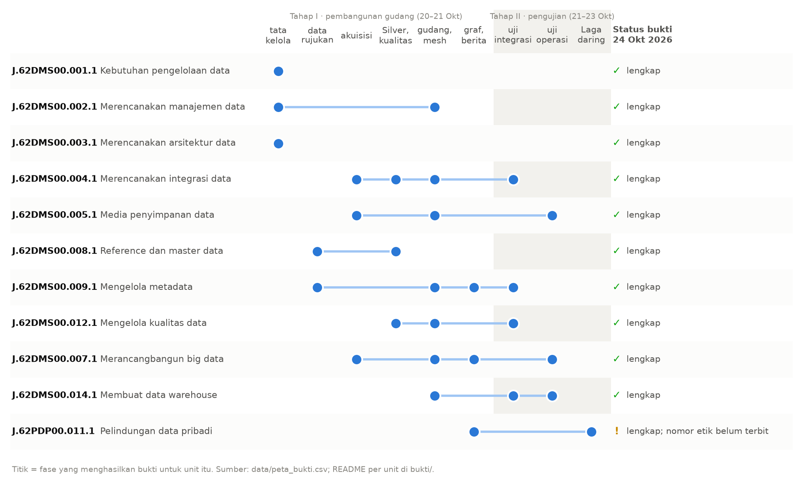

# 1. Pendahuluan

::: {custom-style="Kotak"}
Bab ini menjelaskan persoalan yang melatarbelakangi pekerjaan, yaitu angka indikator SDG resmi yang berbeda antarsumber dan berubah antarrilis, lalu menempatkan pekerjaan pada standar dan skema yang menjadi acuan asesmen. Bagian akhir menjelaskan cara membaca bukti, tiga jenis bukti yang dipakai di seluruh laporan, dan batas penggunaan asisten AI selama pengerjaan.
:::

## 1.1 Latar belakang pekerjaan

Indikator Tujuan Pembangunan Berkelanjutan (TPB/SDGs) untuk Indonesia diterbitkan oleh beberapa lembaga sekaligus. Satu indikator dapat muncul di Badan Pusat Statistik (BPS), di basis data SDG PBB, di World Development Indicators (WDI) Bank Dunia, di ILOSTAT atau WHO sebagai lembaga kustodian, dan untuk tujuan tertentu di kementerian sektoral seperti BNPB, KLH, dan KKP. Angka dari lembaga-lembaga tersebut tidak selalu sama, dan angka dari lembaga yang sama pun dapat berubah dari satu rilis ke rilis berikutnya. Pada penelitian kelompok keahlian sebelumnya, dua kanal milik BPS sendiri, yaitu WebAPI dan publikasi TPB, sudah berbeda pada 33 dari 1.435 sel yang beririsan.

Kondisi ini menjadi persoalan pengelolaan data. Sistem yang hanya menyimpan nilai terkini tidak dapat memanggil kembali angka yang benar pada hari terbitnya. Akibatnya, perbedaan antarsumber tidak dapat dijelaskan, dan pembelajar tidak dapat ditunjukkan dari rilis mana sebuah angka berasal. Contoh yang dipakai sepanjang pekerjaan adalah tingkat pengangguran terbuka (TPT) Agustus 2019. Angka tersebut tertulis 5,28 % pada Berita Resmi Statistik 5 November 2019, sedangkan tabel BPS saat ini menuliskan 5,23 % untuk kunci yang sama. Keduanya benar pada waktunya, dan sistem yang hanya menyimpan nilai terkini kehilangan yang pertama.

Berangkat dari persoalan tersebut, kelompok keahlian membangun gudang indikator SDG multisumber. Gudang ini menyimpan setiap rilis dari sebelas sumber statistik, merekonsiliasi perbedaan antarsumber dengan aturan yang ditetapkan sebelum data dibandingkan, lalu menerbitkan hasilnya sebagai data product per pilar TPB Bappenas dengan kontrak yang diuji. Pekerjaan berlangsung dalam tiga tahap.

1. **Tahap I, pembangunan gudang (20–21 Oktober 2026).** Tahap ini terdiri atas enam fase: tata kelola, data rujukan, akuisisi, Silver dan kualitas, gudang dan data mesh, serta graf pengetahuan dan korpus berita.
2. **Tahap II, pemakaian dan pengujian (21–23 Oktober 2026).** Gudang disambungkan ke graf pengetahuan TPB-KG, paket level Liga Lakehouse versi 4, pemandu AI Bravais, dan dasbor indikator, lalu diuji melalui lima pengujian: integrasi, graf, kompilasi paket, keterikatan jawaban Bravais, serta operasi dan keterulangan.
3. **Tahap III, evaluasi pengguna daring (23 Oktober–16 November 2026).** Paket produksi dipasang di server untuk Laga Liga Lakehouse, yaitu evaluasi pengguna yang dimainkan secara daring.

## 1.2 Tujuan laporan

Laporan ini disusun dengan tiga tujuan:

1. merangkum proyek sebagai satu rangkaian kerja dari sumber data sampai pemakai, sehingga dapat dibaca sebagai satu kesatuan;
2. memetakan hasil kerja ke sebelas unit skema Insinyur Data (Data Engineer) LSP Digital Kreatif Solusi, beserta berkas bukti dan angka yang dapat diperiksa ulang;
3. menyatakan secara terbuka bagian yang belum selesai, sehingga pekerjaan yang sudah dilakukan dapat dibedakan dari pekerjaan yang masih direncanakan.

Laporan ini tidak menambahkan hasil baru. Angka gudang diambil dari naskah teknis penelitian gudang, dan angka pemakaian dari laporan kelima pengujian Tahap II. Ringkasan JSON dan CSV yang menjadi dasar setiap angka disalin ke folder `data/` repositori portofolio; peta salinan ke asalnya ada di `data/asal.tsv`, dan sidik sha256 setiap berkas di `data/SIDIK.txt`. Setiap angka pada Bab 3 dan 4 dapat ditelusuri ke salah satu berkas itu.

## 1.3 Standar dan skema

Standar yang digunakan adalah Keputusan Menteri Ketenagakerjaan Nomor 268 Tahun 2020 tentang Penetapan SKKNI Kategori Informasi dan Komunikasi Golongan Pokok Aktivitas Pemrograman, Konsultasi Komputer, dan Kegiatan YBDI Bidang Data Management System Sub Bidang Data Management, yang ditetapkan pada 26 Juni 2020. Standar ini memuat 22 unit berkode `J.62DMS00.0xx.1` dan mengadaptasi DAMA-DMBOK. Asesmen dilaksanakan di LSP Digital Kreatif Solusi (LSP DKS), LSP pihak ketiga berlisensi BNSP-LSP-2420-ID. Skema Insinyur Data (Data Engineer) di LSP DKS adalah skema okupasi yang memuat sepuluh unit dari SKKNI 268/2020 dan satu unit dari SKKNI 103/2023, yaitu J.62PDP00.011.1.

**Tabel 1.1.** Unit kompetensi skema Insinyur Data (Data Engineer) LSP DKS mengikuti urutan pada halaman skema, dan langkah kerja pada folder `bukti/` yang menjadi buktinya.

| No | Kode unit | Judul unit | Standar | Langkah bukti |
| ---: | --- | --- | --- | --- |
| 1 | J.62DMS00.001.1 | Mengidentifikasi Kebutuhan Pengelolaan Data untuk Proses Bisnis | SKKNI 268/2020 | 01 Kebutuhan data |
| 2 | J.62DMS00.002.1 | Merencanakan Manajemen Data | SKKNI 268/2020 | 02 Rencana manajemen data |
| 3 | J.62DMS00.003.1 | Merencanakan Arsitektur Data | SKKNI 268/2020 | 03 Arsitektur data |
| 4 | J.62DMS00.004.1 | Merencanakan Integrasi Data | SKKNI 268/2020 | 07 Integrasi data |
| 5 | J.62DMS00.005.1 | Merencanakan Media Penyimpanan Data | SKKNI 268/2020 | 06 Media penyimpanan |
| 6 | J.62DMS00.007.1 | Merancangbangun Big Data | SKKNI 268/2020 | 10 Big data dan operasi |
| 7 | J.62DMS00.008.1 | Mengelola Reference and Master Data | SKKNI 268/2020 | 04 Data rujukan dan master |
| 8 | J.62DMS00.009.1 | Mengelola Metadata | SKKNI 268/2020 | 05 Metadata |
| 9 | J.62DMS00.012.1 | Mengelola Kualitas Data | SKKNI 268/2020 | 08 Kualitas data |
| 10 | J.62DMS00.014.1 | Membuat Data Warehouse | SKKNI 268/2020 | 09 Gudang data |
| 11 | J.62PDP00.011.1 | Menerapkan Program Kerja Pelindungan Data Pribadi | SKKNI 103/2023 | 11 Pelindungan data pribadi |

Bab 3 tidak mengikuti urutan nomor unit, melainkan urutan pekerjaan yang sebenarnya: merencanakan (langkah 01–03), menyiapkan acuan (04–05), membangun (06–09), lalu menjalankan (10–11). Urutan ini dipilih karena setiap langkah memakai hasil langkah sebelumnya, misalnya bukti big data memakai hasil gudang dan uji kualitas yang dijelaskan lebih dulu.

**Gambar 1.** Peta bukti: fase pekerjaan yang menghasilkan bukti untuk setiap unit dan status bukti per 24 Oktober 2026. Kesebelas unit berstatus lengkap; unit PDP membawa satu catatan terbuka tentang nomor persetujuan etik.

## 1.4 Cara membaca bukti

Setiap folder `bukti/<nomor>-<nama>/` berisi satu `README.md` yang menjawab empat hal: pertanyaan apa yang dijawab langkah itu, apa yang dikerjakan asesi dengan kata-kata sendiri, bukti per elemen unit beserta jenis dan statusnya, dan catatan terbuka tentang yang belum selesai. Di bawahnya, pemetaan rinci per KUK ditulis dengan rujukan ke berkas di `data/` dan `code/`. Aturan bukti mengikuti Pedoman BNSP 301-2013: valid (menjawab elemen yang dinilai), asli (pekerjaan asesi sendiri yang dapat dijelaskan tanpa membaca), terkini (menyebut tanggal jalan atau tanggal keputusan), dan memadai (setiap elemen punya sedikitnya satu bukti).

Bukti dikelompokkan menjadi tiga jenis, mengikuti pembagian bukti langsung, tidak langsung, dan tambahan pada asesmen portofolio.

- **L, bukti langsung: artefak yang berjalan.** Kode, konfigurasi, dan uji yang dapat dijalankan ulang dengan satu perintah `make`, misalnya `make m1-test` atau job Dagster `gudang_penuh`, serta layanan yang sedang berjalan di produksi. Salinan kode yang dirujuk ada di `code/`.
- **TL, bukti tidak langsung: keluaran terukur.** Manifest dan ringkasan hasil jalan, misalnya `m4_sidik_gold.json` untuk bukti rebuild dan `m3_kualitas.json` untuk ukuran kualitas, semuanya di `data/`.
- **T, bukti tambahan: dokumen tata kelola.** Piagam, matriks RACI, inventaris aset, analisis peraturan, surat izin, dan berkas etik.

Setiap langkah pada Bab 3 ditutup dengan status **lengkap** apabila setiap elemen sudah mempunyai bukti, disertai catatan terbuka bila ada bagian yang masih menunggu keputusan atau pihak luar. Hal yang belum dicocokkan dengan teks resmi atau masih menunggu keputusan penanggung jawab dinyatakan pada langkah yang bersangkutan dan dirangkum pada Bab 5.

## 1.5 Pernyataan penggunaan asisten AI

Gagasan proyek, pemilihan rancangan, dan setiap keputusan teknis berasal dari asesi. Dalam pengerjaannya, asisten AI (Claude) dipakai untuk membantu menulis kode dan dokumen serta untuk mengusulkan langkah teknis, yang kemudian diputuskan oleh asesi. Keputusan pokok, seperti model operasional federasi, aturan rekonsiliasi, kelas tayang menurut lisensi, skema bitemporal, keputusan tidak memakai Spark, dan perbaikan setiap insiden, tercatat bertanggal pada dokumen rencana kerja dan catatan rencana uji di repositori penelitian. Lampiran 6.1 merangkum keputusan-keputusan tersebut beserta alternatif yang dipertimbangkan dan alasannya. Asesi bertanggung jawab penuh atas isi laporan ini dan harus dapat menjelaskan setiap keputusan di dalamnya tanpa membaca dokumen.
