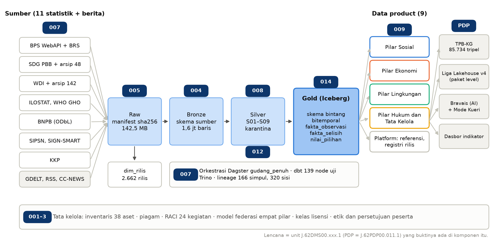
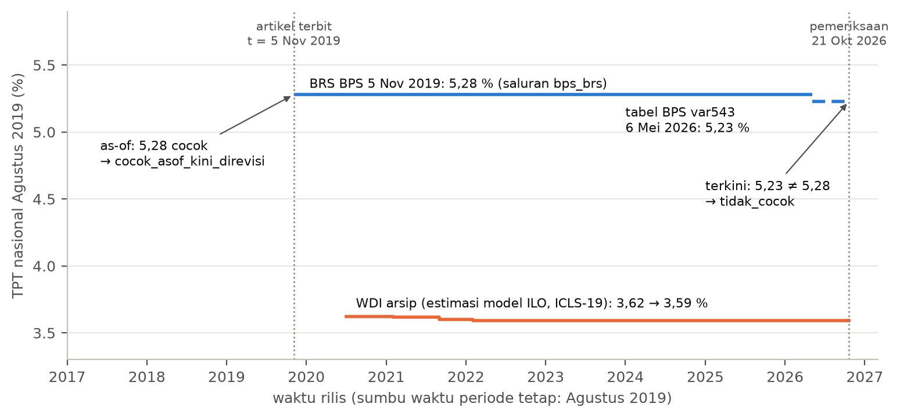
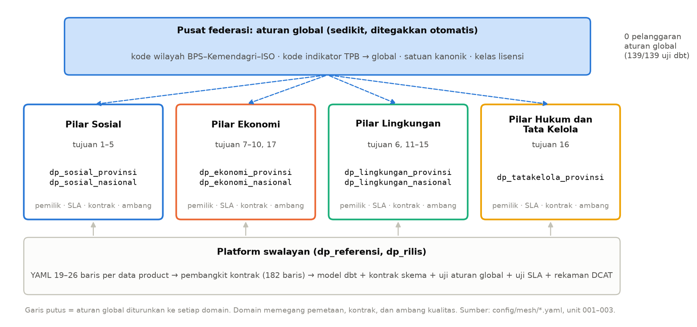

# 2. Gambaran Proyek

::: {custom-style="Kotak"}
Gudang indikator SDG multisumber menyimpan 2.662 rilis dari sebelas sumber statistik, memetakannya ke kode kanonik, merekonsiliasi perbedaan antarsumber, dan menerbitkan sembilan data product berkontrak yang dipakai oleh graf pengetahuan, paket level Liga Lakehouse, pemandu AI Bravais, dan dasbor. Bab ini menjelaskan organisasi, sumber data, arsitektur, stack teknologi, model data mesh, pemakaian hasil, serta keadaan pekerjaan pada 27 Oktober 2026.
:::

## 2.1 Organisasi dan proses bisnis

Organisasi yang dinilai adalah Kelompok Keahlian Program Studi Sains Data ITERA sebagai pengelola Liga Lakehouse, yaitu game edukasi indikator SDG yang berjalan di Data Science Workbench (DSW, `sd.itera.ac.id`), beserta lakehouse riset yang memasoknya. Kelompok keahlian menjalankan tiga fungsi yang memakai data: penelitian rekonsiliasi statistik resmi multisumber, layanan pembelajaran melalui Liga Lakehouse dan pemandu AI Bravais, serta pengajaran pada mata kuliah Pergudangan Data dan Data Wrangling. Proses bisnis pokoknya dimulai dari mengunduh rilis resmi, kemudian merekonsiliasi dan menyimpan setiap rilis, mengompilasi paket level, menyajikannya kepada pemain, dan akhirnya mengevaluasi kegunaannya.

Seluruh pekerjaan diikat oleh satu prinsip tata kelola: setiap angka indikator SDG resmi Indonesia yang pernah terbit harus dapat dipanggil ulang, ditelusuri sampai rilisnya, dan dijelaskan kepada pembelajar.

## 2.2 Sumber data

Pada fase akuisisi, data diambil dari sebelas sumber statistik dan tiga sumber berita. Setiap payload ditulis apa adanya ke lapis Raw dengan manifest sha256, lalu setiap rilis didaftarkan ke registri `dim_rilis` beserta jenis bukti tanggal rilisnya.

**Tabel 2.1.** Sumber gudang (`data/gudang/volume.json`, registri rilis). Kelas tayang mengikuti keadaan saat pengujian Tahap II; sejak keputusan 22 Oktober 2026 semua sumber statistik masuk kelas A.

| Sumber | Tujuan SDG | Tingkat | Rilis | Bukti tanggal rilis | Kelas tayang |
| --- | --- | --- | ---: | --- | --- |
| BPS WebAPI | 1–11, 15–17 | provinsi, nasional | 73 | pembaruan sumber, rilis resmi | A |
| BPS Berita Resmi Statistik | indikator yang dirilis lewat BRS | nasional | 2.143 | rilis resmi | A |
| Basis data SDG PBB (API dan arsip 48 rilis) | 1–17 | nasional | 49 | rilis resmi | B |
| WDI (API dan arsip 142 versi) | banyak tujuan | nasional | 143 | rilis resmi, pembaruan sumber | A |
| ILOSTAT | 1, 5, 8, 10 | nasional | 26 | pembaruan sumber | A |
| WHO GHO | 2, 3, 6 | nasional | 42 | pembaruan sumber | A |
| BNPB | 13 (juga 1.5, 11.5) | provinsi, kab/kota | 113 | pembaruan sumber | A-SA (ODbL) |
| SIPSN KLH | 12 | kab/kota | 2 | tanggal unduh | B |
| SIGN-SMART KLH | 13 | provinsi | 28 | tanggal unduh | B |
| KKP | 14 | provinsi, nasional | 43 | tanggal unduh | B |
| GDELT, RSS, CC-NEWS | klaim berita | – | 16 | tanggal unduh | C (tidak tayang) |

Secara keseluruhan tercatat 2.662 rilis data statistik, Raw sebesar 142,5 MB dalam 889 berkas, dan Bronze sebesar 32,7 MB atau 1.607.907 baris. Kelas tayang ditentukan oleh lisensi. Kelas A bersifat terbuka, kelas A-SA wajib berlisensi sama, kelas B hanya dipakai untuk rekonsiliasi sampai statusnya jelas, dan kelas C tidak pernah ditayangkan. Pada 22 Oktober 2026 diputuskan bahwa basis data SDG PBB, SIPSN, SIGN-SMART, dan KKP diperlakukan sebagai data publik dengan atribusi wajib, sehingga keempatnya masuk kelas A untuk paket Laga. Perubahan tersebut hanya menyentuh seed lisensi. Gudang kemudian dibangun ulang dari awal dengan sidik baru `1b8c95e3…`, sedangkan angka pada laporan ini tetap mengacu pada Gold `657df68e…`.

## 2.3 Arsitektur

Gudang disusun sebagai lakehouse berlapis (medallion) (Raw, Bronze, Silver, Gold) dengan skema bintang bitemporal di lapis Gold dan data product per pilar TPB di atasnya. Gambar 2 menandai setiap komponen dengan unit kompetensi yang buktinya berada pada komponen tersebut.

**Gambar 2.** Arsitektur dari sumber sampai pemakai, bertanda unit kompetensi. Lencana biru tua menunjuk unit J.62DMS00.xxx.1 yang buktinya berada pada komponen tersebut; PDP adalah J.62PDP00.011.1.

**Tabel 2.2.** Aturan per lapis.

| Lapis | Isi | Aturan |
| --- | --- | --- |
| Raw | payload asli per sumber per unduhan | hanya bertambah, tidak pernah ditimpa; manifest sha256 |
| Bronze | payload diurai menjadi baris apa adanya | dapat dibangun ulang tanpa jaringan dari Raw |
| Silver | baris dipetakan ke kode kanonik indikator, wilayah, periode, satuan | aturan bernomor S01–S09; baris yang gagal masuk karantina dengan alasan, tidak dibuang |
| Gold | skema bintang bitemporal | satu fakta per (sumber, rilis, seri, wilayah, periode, rincian) |
| Data product | tampilan per pilar dengan kontrak | dibangkitkan dari YAML; kontrak diuji pada setiap jalan |
| Sajian | TPB-KG, paket level, Bravais, dasbor | hanya kelas yang boleh tayang |

Inti rancangan gudang adalah pemisahan tiga sumbu waktu. **Waktu periode** adalah tahun atau bulan yang diukur oleh indikator. **Waktu rilis** adalah saat produsen menerbitkan nilai, beserta jenis buktinya. **Waktu catat** adalah saat baris ditulis ke tabel, yang disediakan oleh snapshot Iceberg. Query as-of memakai waktu rilis, sedangkan time travel Iceberg memakai waktu catat.

**Gambar 3.** Tiga sumbu waktu pada satu kunci (TPT nasional Agustus 2019). Angka yang benar pada hari terbitnya (5,28 % di BRS 5 November 2019) berbeda dari nilai terkini (5,23 %), dan keduanya tersimpan di gudang. Sumber: naskah penelitian gudang.

## 2.4 Stack teknologi

**Tabel 2.3.** Stack teknologi dan alasan pemilihannya (`code/infra/gudang/compose.yml`).

| Fungsi | Alat dan versi | Alasan |
| --- | --- | --- |
| Object storage | SeaweedFS 3.97 (antarmuka S3) | pengganti MinIO karena registri citra MinIO tidak terjangkau dari lingkungan pembangun; antarmuka S3 tetap standar |
| Format tabel dan katalog | Apache Iceberg, katalog REST 1.8.1 | snapshot dan time travel untuk waktu catat |
| Query engine | Trino 476 | sudah diukur pada benchmark sebelumnya; tersedia adaptor dbt |
| Pemuatan | PyIceberg 0.12.0 | Silver hanya sekitar 1,5 juta baris, sehingga Spark (citra 2,4 GB) tidak diperlukan |
| Transformasi dan uji | dbt-core 1.12.6, dbt-trino 1.10.6 | model, uji, kontrak, dan lineage dalam satu alat |
| Orkestrasi | Dagster 1.13.26 | aset Dagster sepadan dengan data product dan dapat membaca lineage dbt |
| Metadata | DCAT per data product, dbt docs, katalog Iceberg REST | OpenMetadata penuh memerlukan sekitar 40 GiB RAM dan tidak muat pada node 16 GB |
| Graf pengetahuan | RDF, validasi SHACL dengan pySHACL | ringan dan dapat berjalan pada satu simpul |
| Sajian | SQLite di server DSW (Lightsail 4 GB, 2 vCPU) | paket level dan Gold game dimuat ke memori; p95 pemeriksaan jawaban di bawah 1 ms |

Pengembangan awal dilakukan di lingkungan cloud pada 20 Oktober 2026. Setelah itu, seluruh fase Silver, gudang, dan graf dijalankan ulang dari Raw di Mac peneliti (Apple Silicon, RAM 16 GB, Docker melalui Colima dengan VM 4 vCPU dan 8 GiB) pada 21 Oktober 2026. Angka gudang pada laporan ini berasal dari jalan di Mac tersebut.

## 2.5 Data mesh empat pilar TPB

Model operasional tata kelola yang dipilih adalah federasi atau data mesh. Domain mengikuti empat pilar TPB menurut Permen PPN/Kepala Bappenas Nomor 1 Tahun 2024 Pasal 4 ayat (3) sampai (6), karena pembagian tersebut juga menjadi struktur Metadata Indikator TPB dan sudah dikenal oleh pemangku kepentingan di Indonesia.

**Gambar 4.** Model federasi. Aturan global dibuat sedikit dan ditegakkan pusat secara otomatis, domain pilar memegang data product beserta pemilik, SLA, kontrak, dan ambang kualitasnya, sedangkan platform swalayan membangkitkan kontrak dari YAML.

**Tabel 2.4.** Domain dan data product (`code/config/mesh/*.yaml`).

| Domain | Tujuan SDG | Data product |
| --- | --- | --- |
| Pilar Sosial | 1–5 | `dp_sosial_provinsi`, `dp_sosial_nasional` |
| Pilar Ekonomi | 7, 8, 9, 10, 17 | `dp_ekonomi_provinsi`, `dp_ekonomi_nasional` |
| Pilar Lingkungan | 6, 11, 12, 13, 14, 15 | `dp_lingkungan_provinsi`, `dp_lingkungan_nasional` |
| Pilar Hukum dan Tata Kelola | 16 | `dp_tatakelola_provinsi` |
| Platform | – | `dp_referensi` (wilayah, indikator, satuan, konsep), `dp_rilis` (registri rilis) |

Setiap data product dinyatakan sebagai satu berkas YAML sepanjang 19–26 baris yang memuat pemilik, kanal pelaporan masalah, SLA kesegaran, dan aturan kualitas. Pembangkit kontrak (`code/src/sdg_gudang/gudang/kontrak.py`) kemudian menurunkan dari setiap YAML sebuah model dbt, kontrak skema yang ditegakkan dbt, uji aturan global federasi, uji SLA, dan rekaman DCAT. Aturan global, yaitu kode wilayah, kode indikator, satuan, dan kelas lisensi, ditegakkan oleh pusat, sedangkan pemetaan, kontrak, dan ambang kualitas dipegang oleh domain.

## 2.6 Dari gudang ke pemakai

Pada Tahap II, Gold disambungkan ke empat pemakai: graf pengetahuan TPB-KG, kompilator paket level Liga Lakehouse versi 4, pemandu AI Bravais, dan dasbor indikator. Sambungan ini diuji melalui lima pengujian yang rencana analisisnya ditetapkan sebelum data dilihat.

**Tabel 2.5.** Pengujian Tahap II dan relevansinya bagi portofolio (`data/produk/`).

| Pengujian | Yang diuji | Hasil pokok | Langkah |
| --- | --- | --- | --- |
| Uji integrasi | 11 sumber dari 9 keluarga, 1.276 pasangan sumber × sumber | 0,406 selisih terjelaskan; 79 dari 105 indikator berdata boleh tayang | 07, 08 |
| Uji graf | TPB-KG dibangun ulang dari Gold | 85.734 tripel, sha256 identik dengan graf sebelumnya, 0 pelanggaran SHACL | 05 |
| Uji kompilasi paket | kelayakan level dan keterulangan | 1.570 dari 3.820 kandidat lolos; hash paket, Parquet, dan SQLite identik pada dua jalan | 09 |
| Uji keterikatan Bravais | 1.800 jawaban pada tiga kondisi | 86,2 % jawaban terikat ke data saat memakai alat ber-provenans, 0,0 % tanpa alat | 05 |
| Uji operasi dan keterulangan | rebuild gudang dan kompilasi dua kali; latensi produksi | sidik Gold dan hash paket identik; p95 produksi 0,714–0,751 ms; memori tambahan 17,6 MB per worker | 06, 09, 10 |

Sejak 23 Oktober 2026 paket produksi dipasang di Lightsail untuk Laga Liga Lakehouse, yaitu evaluasi pengguna daring yang berlangsung sampai 16 November 2026. Paket produksi dikompilasi dengan kunci rahasia, sehingga isinya berbeda dari paket evaluasi `afbcbeef…` dan tidak pernah di-commit. Kunci dan paket tersebut hanya tersimpan di Mac peneliti dan di server.

## 2.7 Fase dan keadaan pekerjaan

**Tabel 2.6.** Fase dan keadaannya pada 27 Oktober 2026.

| Tahap dan fase | Keluaran | Keadaan |
| --- | --- | --- |
| I.0 Tata kelola dan izin | piagam, RACI, inventaris aset, surat izin, berkas etik | draf lengkap; surat izin belum dikirim, sedangkan status tayang empat sumber diputuskan pada 22 Oktober |
| I.1 Data rujukan dan metadata | `dp_referensi`, dimensi wilayah tipe 2, tulang punggung graf, standar metadata | selesai; 11 uji lulus |
| I.2 Akuisisi multisumber | konektor 12 sumber, manifest, `dim_rilis`, rencana kapasitas | selesai |
| I.3 Silver, rekonsiliasi, kualitas | aturan yang dibekukan, Silver dengan karantina, `fakta_selisih`, laporan kualitas | selesai; dijalankan ulang di Mac |
| I.4 Gudang dan data mesh | skema bintang dbt, 9 data product berkontrak, Dagster, lineage, bukti rebuild | selesai; pemilik domain masih simulasi |
| I.5 Graf pengetahuan dan klaim berita | graf dengan SHACL, pemeriksa klaim as-of, korpus berita | sebagian; anotator sampel emas belum ditetapkan |
| II Pemakaian dan pengujian | TPB-KG, paket v4, Bravais, pemasangan di produksi | selesai 21 Oktober 2026 |
| III Evaluasi pengguna daring | Laga, 23 Oktober–16 November | berjalan; data belum dianalisis sampai nomor etik terbit |
| Portofolio | sebelas folder bukti, salinan kode, laporan ini | bukti dan kode selesai 27 Oktober; berkas asesmen menyusul |

## 2.8 Angka kunci

**Tabel 2.7.** Angka kunci proyek (Gold acuan `657df68e…`, paket evaluasi `afbcbeef…`). Semua berkas sumber ada di `data/`.

| Ukuran | Nilai | Berkas sumber |
| --- | --- | --- |
| Sumber data statistik / keluarga | 11 / 9 | `produk/uji-integrasi.json` |
| Rilis tercatat | 2.662 data statistik + 16 berita | registri rilis; `gudang/m4_sidik_gold.json` (`dim_rilis` 2.678) |
| Observasi `fakta_observasi` | 1.486.490 | `gudang/m4_sidik_gold.json` |
| Pasangan `fakta_selisih` | 1.377.573 | `gudang/m4_sidik_gold.json` |
| Nilai pilihan (semua kelas / boleh tayang) | 109.289 / 81.249 | `gudang/m4_sidik_gold.json` |
| Data product berkontrak | 9 (12 tabel `dp`) | `code/config/mesh/`, `gudang/m4_sidik_gold.json` |
| Uji dbt (node lulus) | 139 / 139 | `gudang/m4_sidik_gold.json`, `uji/uji-sla.json` |
| Pelanggaran aturan global federasi | 0 | uji dbt |
| Kelengkapan lineage | 12/12 tabel data product = 1,00 (166 simpul, 320 sisi) | `gudang/m4_lineage.json` |
| Rebuild dari Raw | empat jalan, sidik Gold identik | `gudang/m4_sidik_gold.json`, `produk/uji-keterulangan.json` |
| Tripel TPB-KG / pelanggaran SHACL | 85.734 / 0 | `gudang/m5_kg_ringkasan.json`, `produk/uji-graf.json` |
| Kelayakan level paket v4 | 1.570 dari 3.820 kandidat lolos | `produk/uji-kompilasi.json` |
| p95 pemeriksaan jawaban di produksi | 0,714–0,751 ms | `produk/latensi-produksi-*.json` |
| Uji SLA antarlapis (24 Okt) | 45 dari 46 pemeriksaan lulus; API tanpa kompresi gagal, lulus dengan gzip | `uji/uji-sla.json`, `uji/uji-sla-api.json` |
| Ingest GDELT 14–20 Okt | 8,42 GB zip dialirkan pada 11,6 MB/s, 14 dari 14 aliran-hari lengkap | `uji/uji-sla-gdelt.json` |
