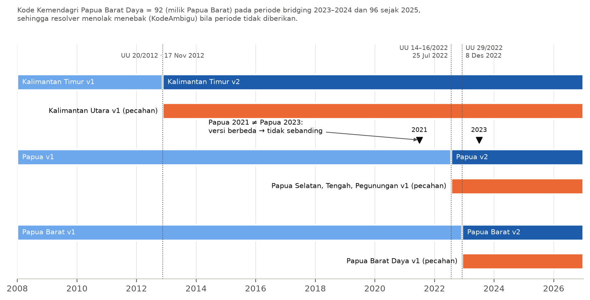
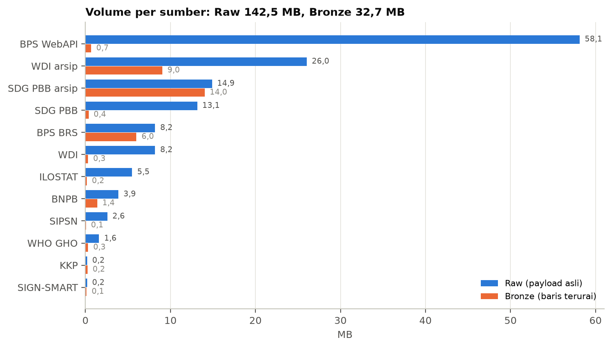
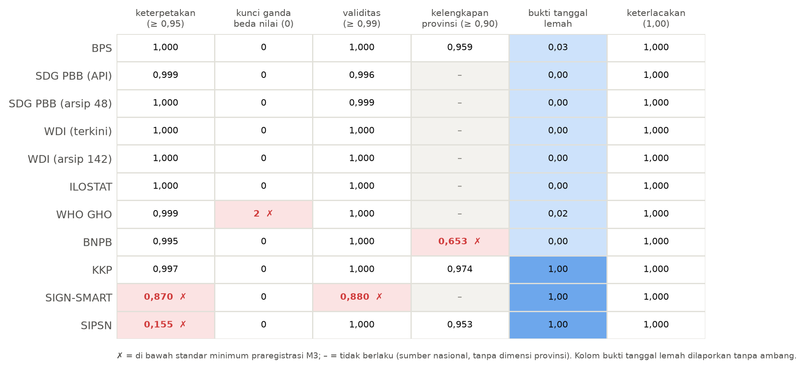
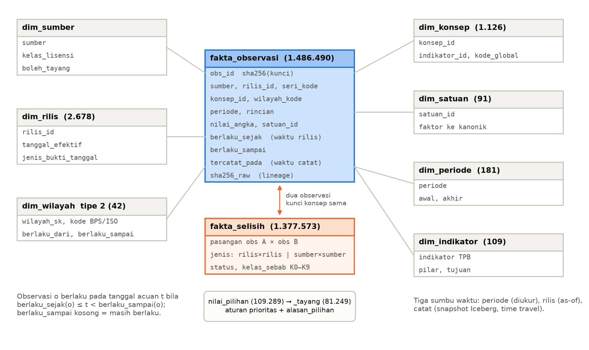
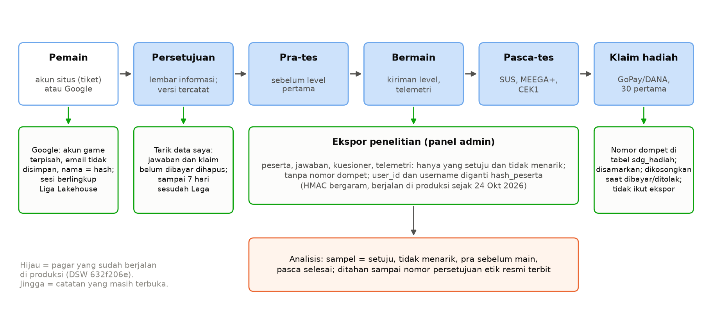

# 3. Bukti per Langkah Kerja

::: {custom-style="Kotak"}
Bab ini memetakan hasil kerja ke sebelas unit skema menurut urutan pekerjaan yang sebenarnya, satu subbab untuk setiap folder `bukti/`. Untuk setiap langkah disajikan pertanyaan yang dijawab, pekerjaan yang dilakukan, bukti per elemen beserta jenisnya, alasan rancangan, dan catatan terbuka. Pemetaan rinci per KUK berada di `bukti/<langkah>/README.md`, dan setiap angka di bab ini menunjuk ke berkas di `data/`.
:::

**Tabel 3.1.** Ringkasan status bukti per langkah (27 Oktober 2026). Status "lengkap" berarti setiap elemen mempunyai sedikitnya satu bukti; catatan terbuka dirinci pada subbab masing-masing dan dirangkum di Bab 5.

| Langkah | Unit | Status | Catatan terbuka |
| --- | --- | --- | --- |
| 01 Kebutuhan data | J.62DMS00.001.1 | lengkap | pemilik domain masih simulasi; inventaris potret 20 Oktober |
| 02 Rencana manajemen data | J.62DMS00.002.1 | lengkap | pengisi peran pemilik domain dan jadwal kelas evaluasi belum diputuskan |
| 03 Arsitektur data | J.62DMS00.003.1 | lengkap | Perpres 39/2019 belum dicocokkan dengan teks resmi |
| 04 Data rujukan dan master | J.62DMS00.008.1 | lengkap | pemekaran sebelum 2012 belum dimodelkan; ruang nama IRI sementara |
| 05 Metadata | J.62DMS00.009.1 | lengkap | repositori metadata versi ringan; 72 satuan lokal belum dikurasi |
| 06 Media penyimpanan | J.62DMS00.005.1 | lengkap | kompatibilitas S3 bucket Lightsail belum diperiksa |
| 07 Integrasi data | J.62DMS00.004.1 | lengkap | 414 selisih antarsumber belum terjelaskan oleh aturan beku |
| 08 Kualitas data | J.62DMS00.012.1 | lengkap | dua tindakan menunggu produsen; dua keterbatasan kerangka dicatat |
| 09 Gudang data | J.62DMS00.014.1 | lengkap | dua Gold dengan sidik berbeda; time travel belum diuji resmi |
| 10 Big data dan operasi | J.62DMS00.007.1 | lengkap | tanpa klaster terdistribusi; klaim dibatasi pada volume yang diuji |
| 11 Pelindungan data pribadi | J.62PDP00.011.1 | lengkap | nomor persetujuan etik resmi belum terbit |

## 3.1 Kebutuhan data

::: {custom-style="Label Unit"}
J.62DMS00.001.1 Mengidentifikasi Kebutuhan Pengelolaan Data untuk Proses Bisnis · SKKNI 268/2020 · bukti dari fase tata kelola · status: lengkap
:::

Langkah ini menjawab pertanyaan: data apa saja yang dimiliki dan dipakai organisasi, dan mengapa harus dikelola. Asesi menginventarisasi 38 aset data yang dimiliki dan dipakai pengelola Liga Lakehouse pada 20 Oktober 2026, yaitu 24 aset yang sudah ada dan 14 yang masih direncanakan, lalu menempatkan setiap aset pada tatanan kerja organisasi lengkap dengan steward, kelas lisensi, sensitivitas, dan masa retensinya. Dari inventaris itu diturunkan empat aturan penanganan aset dan dipilih model operasional tata kelola federasi.

| Elemen | Pekerjaan | Bukti |
| --- | --- | --- |
| 1. Bentuk aset data dan aspek pengelolaannya | tiga fungsi organisasi yang memakai data; 38 aset dalam delapan kelompok menurut aktivitas pemakainya; empat aturan penanganan (Raw hanya bertambah, turunan dapat dibangun ulang, data pribadi dipisah, lisensi menentukan tayang); keselarasan dengan sasaran 2026; dua insiden yang menjadi aturan kontrak | `data/serkom/inventaris-aset-data.csv` (TL); uji kontrak dan kelayakan (L) |
| 2. Aspek tata kelola aset data | setiap aset dipetakan ke tujuh tatanan kerja lewat kolom `pilar` dan `steward`; ranah keputusan data dipisah dari TI lewat kolom `ranah_tata_kelola` | kolom inventaris (TL); RACI langkah 02 (T) |
| 3. Tipe model operasional tata kelola | model terpusat, tereplikasi, dan terdistribusi dibandingkan pada keadaan organisasi ini; federasi dipilih | tabel perbandingan di README (T) |
| 4. Unsur data stewardship | tanggung jawab steward atas metadata; aturan yang berversi di git; enam isu kualitas yang sudah teridentifikasi; kepatuhan sebagai pemeriksaan otomatis | kolom `steward` (TL); `code/config/` (L) |

**Alasan rancangan.** Inventaris diturunkan dari folder dan tabel yang nyata pada 20 Oktober 2026, bukan dari rancangan: ukuran diukur dengan `du`, dan nama tabel layanan diambil dari skema basis data DSW. Aset yang belum ada diberi status `rencana` beserta fasenya, sehingga asesor dapat membedakan yang sudah dikerjakan dari yang direncanakan. Model federasi dipilih karena sumber bertambah dari satu produsen menjadi lebih dari sepuluh dengan pengetahuan domain yang berbeda, sedangkan kode wilayah, kode indikator, dan satuan harus sama di semua pilar agar level lintas tujuan dan Kartu Keterkaitan dapat dibentuk. Peningkatan berkesinambungan dibuktikan dengan dua insiden yang perbaikannya menjadi aturan: benih acak paket v3 yang memuat label versi (kini parameter `versi_benih` dalam kontrak) dan penilai harness yang membaca satuan "per 1.000" sebagai angka (dijadwalkan sebagai versi penilai baru, bukan diterapkan diam-diam).

**Catatan terbuka.** Keempat domain pilar masih dipegang asesi sendiri, sehingga kolom `steward` menyebut peran, bukan orang yang sudah ditunjuk. Inventaris adalah potret 20 Oktober: sebagian aset berstatus `rencana` sudah dikerjakan pada fase M1–M5, dan keputusan repositori metadata berubah dari OpenMetadata menjadi versi ringan; kolom status sengaja tidak disegarkan agar sidik berkas tetap cocok, dan perubahannya dicatat di README. Surat izin untuk sumber kelas B masih draf.

## 3.2 Rencana manajemen data

::: {custom-style="Label Unit"}
J.62DMS00.002.1 Merencanakan Manajemen Data · SKKNI 268/2020 · bukti dari fase tata kelola dan gudang · status: lengkap
:::

Langkah ini menjawab pertanyaan: siapa memutuskan apa, dengan prinsip apa, dan kapan. Asesi menulis piagam tata kelola data Liga Lakehouse pada 20 Oktober 2026, sebelum gudang dibangun, yang memuat enam faktor penggerak terukur, visi, lima misi, tujuh prinsip, dan delapan kriteria keberhasilan yang dibekukan sampai 31 Desember 2026. Tanggung jawab dituangkan dalam matriks RACI (Responsible, Accountable, Consulted, Informed) 24 kegiatan × 10 peran dengan aturan satu penanggung gugat per kegiatan.

| Elemen | Pekerjaan | Bukti |
| --- | --- | --- |
| 1. Faktor penggerak, visi, misi, prinsip | enam faktor penggerak dari pengukuran dan dokumen yang ada (misalnya 33 dari 1.435 sel beririsan berbeda antara dua kanal BPS); visi, lima misi, tujuh prinsip DAMA-DMBOK dengan penerapannya; kesiapan sepuluh proses internal; delapan kriteria keberhasilan terukur | README langkah 02 (T, TL) |
| 2. Struktur dan tanggung jawab | struktur tujuh peran internal dan empat pihak luar; RACI 24 kegiatan × 10 peran, termasuk tiga kegiatan PDP yang ditambahkan 26 Oktober | `data/serkom/raci.csv` (T) |
| 3. Kerangka waktu | empat periode sasaran, aturan pembekuan kriteria bersama praregistrasi, tata waktu M0–M9 | README langkah 02 (T) |
| 4. Faktor penentu keberhasilan | delapan faktor dengan ukuran dan target; status dicatat pada 20 dan 24 Oktober | `data/gudang/m4_sidik_gold.json`, `m4_lineage.json`, `data/produk/uji-keterulangan.json` (TL) |

**Alasan rancangan.** Setiap kegiatan punya tepat satu penanggung gugat supaya selalu jelas siapa yang memutuskan; bila pengerja dan penanggung gugatnya sama, ditulis A/R. Prinsip dipasangkan dengan penerapannya karena prinsip yang tidak punya bentuk teknis tidak akan ditegakkan. Kriteria keberhasilan dibekukan pada M0 bersama praregistrasi, dan ambang yang menyangkut hasil penelitian tidak boleh diubah setelah data terkait dilihat. Status 24 Oktober hanya memuat angka yang ada di `data/`: sidik Gold identik pada empat rebuild, lineage 166 simpul dan 320 sisi tanpa data product yang terputus dari Raw, dan 139 node dbt lulus.

**Catatan terbuka.** Pengisi peran pemilik domain belum diputuskan resmi; pilihan (a), yaitu asesi sendiri sebagai simulasi, berjalan de facto, sedangkan pilihan (b), empat kelompok mahasiswa Pergudangan Data, masih terbuka. Jadwal kelas evaluasi (M7) bergantung pada persetujuan etik. Dua faktor belum pernah diukur: kesegaran, karena konektor belum berjadwal, dan kemudahan menambah sumber.

## 3.3 Arsitektur data

::: {custom-style="Label Unit"}
J.62DMS00.003.1 Merencanakan Arsitektur Data · SKKNI 268/2020 · bukti dari fase tata kelola dan gudang · status: lengkap
:::

Langkah ini menjawab pertanyaan: model tata kelola apa yang cocok dengan budaya dan peraturan organisasi. Asesi memilih model federasi (data mesh) dengan menguraikan arah tarikan setiap faktor penggerak: yang menuntut pengetahuan domain ditarik ke desentralisasi, yang menuntut kode dan lisensi yang sama ditarik ke sentralisasi. Hasilnya empat domain pilar TPB memiliki data product masing-masing, sedangkan tim platform menegakkan empat aturan global secara otomatis.

| Elemen | Pekerjaan | Bukti |
| --- | --- | --- |
| 1. Model operasional tata kelola | lima unsur tata kelola dipetakan ke strategi TI, arsitektur data, dan integrasi aplikasi; arah tarikan lima penggerak; model federasi diwujudkan sebagai sembilan data product berkontrak (12 tabel `dp`) | `code/config/mesh/*.yaml` (L); `data/gudang/m4_sidik_gold.json` (TL) |
| 2. Pengaruh budaya organisasi | lima faktor penerimaan kedisiplinan dan lima faktor kemampuan beradaptasi; siklus semester sebagai faktor penentu | README langkah 03 (T) |
| 3. Pengaruh peraturan | tujuh peraturan dan ketentuan (UU 16/1997, Perpres 39/2019, UU 14/2008, UU 28/2014, UU 27/2022, lisensi sumber, kode etik penelitian) beserta pola pikir yang dibentuk; lima penanda dini bila model tidak tepat | README langkah 03 (T) |

**Alasan rancangan.** Faktor budaya yang paling menentukan adalah siklus semester. Bila peran domain diisi mahasiswa, orangnya berganti setiap semester, sehingga pengetahuan domain hanya bertahan bila tersimpan di kontrak, metadata, dan uji yang berjalan sendiri. Karena itu model ini menempatkan aturan yang dapat dieksekusi di atas dokumen yang harus dibaca, dan wujudnya terlihat pada fase gudang: setiap data product adalah satu berkas YAML 19–26 baris, dan pembangkit kontrak menurunkan darinya model dbt, kontrak skema, uji aturan global, uji SLA, dan rekaman DCAT. Tiga keputusan teknis berubah dari bagan 20 Oktober saat dibangun, masing-masing dengan alasan yang terukur: Spark tidak dipakai (langkah 10), orkestrator ditetapkan Dagster (langkah 09), dan katalog metadata memakai versi ringan (langkah 05). UU 16/1997 membedakan statistik dasar oleh BPS dan statistik sektoral oleh instansi, sehingga data KLH, KKP, dan BNPB sah sebagai sumber resmi dengan pemilik berbeda; UU 28/2014 menjadi dasar kebijakan berita: angka tidak dilindungi hak cipta, sehingga yang disimpan hanya tupel angka dan cuplikan paling banyak dua kalimat.

**Catatan terbuka.** Sisi organisasi federasi (dua orang berbeda memegang domain berbeda di bawah aturan global yang sama) belum pernah diuji; sisi teknisnya terbukti lewat uji aturan global yang berjalan tanpa pelanggaran. Rujukan Perpres 39/2019 belum dicocokkan pasal demi pasal dengan teks resmi.

## 3.4 Data rujukan dan master

::: {custom-style="Label Unit"}
J.62DMS00.008.1 Mengelola Reference and Master Data · SKKNI 268/2020 · bukti dari fase data rujukan dan Silver · status: lengkap
:::

Langkah ini menjawab pertanyaan: kode wilayah, indikator, dan satuan mana yang menjadi acuan bersama semua sumber. Lima kebutuhan data rujukan dan master diturunkan dari masalah yang benar-benar terjadi saat menggabungkan lebih dari sepuluh sumber, lalu dibangun dimensi wilayah tipe 2 yang tahan pemekaran, tabel padanan kode BPS, Kemendagri, dan ISO per periode, dimensi indikator TPB berpadanan kode global, satuan kanonik, dan tulang punggung graf pengetahuan yang divalidasi SHACL.

| Elemen | Pekerjaan | Bukti |
| --- | --- | --- |
| 1. Kebutuhan reference dan master data | lima kebutuhan dari kesalahan nyata; analisis delapan sumber rujukan; definisi data yang dipakai semua tabel (`wilayah_kode`, masa berlaku versi, `padanan_global`, penyebut satuan rasio) | README langkah 04 (T) |
| 2. Membangun | `dim_pilar` (4), `dim_indikator` (109), `dim_satuan` (18 kanonik, 91 di gudang dengan satuan lokal), `alias_wilayah` (82), `dim_wilayah` tipe 2 (42 baris), `padanan_kode_wilayah` (186), `peta_tabel_indikator` (76 tabel, 22 lewat keputusan steward), tulang punggung KG 3.305 tripel lulus SHACL | `data/gudang/m4_sidik_gold.json` (tabel `dp_referensi_*`) (TL); `code/src/sdg_gudang/referensi.py` (L) |
| 3. Menggunakan dan mengelola perubahan | satu resolver `Rujukan` untuk semua konsumen; lima jenis perubahan dengan cara penanganan yang tidak menghapus keadaan lama; 11 uji unit termasuk kasus Papua dan SIGN-SMART | `code/tests/unit/test_sdg_gudang_referensi.py` (L); `data/gudang/m5_kg_ringkasan.json` (TL) |

**Gambar 5.** Dimensi wilayah tipe 2: versi provinsi sebelum dan sesudah pemekaran 2012 dan 2022. Pengamatan Papua 2021 dan Papua 2023 jatuh pada versi wilayah yang berbeda, sehingga deret yang melintasi pemekaran ditandai tidak sebanding.

**Alasan rancangan.** Aspek kritis unit ini adalah ketepatan definisi data, dan tiga definisi lahir dari kesalahan yang benar-benar terjadi: kode Papua tertukar antara BPS (94) dan Kemendagri (91); `KODE_PROV` pada GeoJSON 38 provinsi tidak unik (empat provinsi Papua berkode 91), sehingga tidak dapat dipakai sebagai kunci; dan satuan "per 1.000" terbaca sebagai nilai oleh penilai otomatis jawaban Bravais versi pertama. Perubahan dikelola tanpa menebak: kode Kemendagri Papua Barat Daya sama dengan Papua Barat (92) pada periode bridging 2023 dan 2024, lalu menjadi 96 mulai 2025, dan resolver menimbulkan galat `KodeAmbigu` bila periode tidak diberikan. Setelah dimuat ke gudang, tabel yang sama muncul sebagai `dp_referensi_wilayah` (42 baris), `dp_referensi_indikator` (109), `dp_referensi_satuan` (91), dan `dp_referensi_konsep` (1.126); graf penuh TPB-KG di atas tulang punggung ini memuat 85.734 tripel dan lulus SHACL tanpa pelanggaran.

**Catatan terbuka.** Nama tabel v3 `sdg3_3_2_1_v1584` menyesatkan karena isinya angka kematian bayi, bukan 3.2.1; isi level tidak terpengaruh. Arti tanda `*` dan `()` baru dipastikan dari legenda halaman Metadata SDGs Bappenas, belum dari buku metadata 2024. Pemekaran sebelum 2012 belum dimodelkan, dan ruang nama IRI graf masih sementara.

## 3.5 Metadata

::: {custom-style="Label Unit"}
J.62DMS00.009.1 Mengelola Metadata · SKKNI 268/2020 · bukti dari fase data rujukan, gudang, graf, dan uji keterikatan · status: lengkap
:::

Langkah ini menjawab pertanyaan: bagaimana orang lain tahu isi, asal, dan pemilik setiap data. Kebutuhan metadata ditetapkan dari tiga kelompok konsumen yang pertanyaannya berbeda (pemain dan Bravais, pemilik domain, tim platform), lalu disusun standar wajib per data product dengan kosakata DCAT dan PROV serta padanan konsep SDMX. Metadata tidak ditulis tangan: rekaman DCAT, manifest sha256, kontrak dbt, dan lineage dibangkitkan dari konfigurasi data product pada setiap jalan job.

| Elemen | Pekerjaan | Bukti |
| --- | --- | --- |
| 1. Kebutuhan metadata | tiga konsumen dipetakan ke jenis metadata bisnis, tata kelola, dan teknis; arsitektur empat lapis; standar wajib per data product, distribusi, dan observasi | README langkah 05 (T) |
| 2. Membangun metadata | `metadata.jsonld` dan manifest dari pembangun `dp_referensi`; 9 rekaman DCAT per data product; kontrak dbt dari YAML; lineage 166 simpul dan 320 sisi; TPB-KG 85.734 tripel sebagai metadata semantik | `data/gudang/m4_lineage.json`, `m5_kg_ringkasan.json`, `data/produk/uji-graf.json` (TL); `code/src/sdg_gudang/gudang/kontrak.py`, `kg.py`, `lineage.py` (L) |
| 3. Menggunakan metadata | metadata didistribusikan di tempat yang sama dengan data (tabel `dp_referensi_*`, `dp_rilis`, kolom provenans per baris); analisis cakupan indikator dari metadata saja; provenans sebagai alat Bravais; tiga mekanisme pemeliharaan | `data/produk/uji-keterikatan.json` (TL); uji `test_gudang_kontrak` (L) |

**Alasan rancangan.** OpenMetadata tidak dipasang karena spesifikasi produksinya memerlukan sekitar 40 GiB RAM dan tidak muat bersama Trino pada node 16 GB; batasan variabel unit membolehkan repositori metadata di alat lain, sehingga dipakai versi ringan: rekaman DCAT per data product, katalog Iceberg REST, dokumentasi dbt, dan lineage JSON. Metadata tidak ditulis tangan agar tidak tertinggal dari datanya: aset Dagster `kontrak_mesh` dan uji `test_gudang_kontrak` gagal bila berkas yang di-commit berbeda dari konfigurasinya. Dua contoh pemakaian membuktikan gunanya. Tanpa membaca nilai data, metadata menunjukkan bahwa baru 51 dari 105 indikator katalog TPB (48,6 %) mempunyai tabel di Gold v3, dan hasil ini menjadi prioritas akuisisi. Pada uji keterikatan (penilai v2), dari 595 jawaban Bravais dengan alat ber-provenans 513 (86,2 %) terikat ke angka gudang, sedangkan dari 600 jawaban tanpa alat 0 (0,0 %) terikat; selisih proporsinya 0,862 dengan selang kepercayaan 0,831–0,888.

**Catatan terbuka.** Pencarian metadata lintas data product masih lewat berkas JSON-LD dan katalog Iceberg, belum lewat antarmuka katalog. Metadata DCAT baru menjangkau 9 data product; tabel Bronze dan Silver baru punya metadata teknis. 72 satuan lokal belum dikurasi, dan pemeriksaan klaim berita baru menjangkau dua indikator.

## 3.6 Media penyimpanan

::: {custom-style="Label Unit"}
J.62DMS00.005.1 Merencanakan Media Penyimpanan Data · SKKNI 268/2020 · bukti dari fase akuisisi, gudang, dan uji operasi · status: lengkap
:::

Langkah ini menjawab pertanyaan: seberapa besar datanya, akan tumbuh berapa, dan disimpan di mana. Volume setiap lapis diukur per sumber setelah akuisisi 12 sumber selesai pada 20 Oktober 2026, lalu pertumbuhannya ditaksir dari frekuensi rilis yang terukur di registri 2021–2026. Karena volumenya kecil, yang menentukan pilihan media bukan kapasitas simpan melainkan jenis data dan memori komputasi.

| Elemen | Pekerjaan | Bukti |
| --- | --- | --- |
| 1. Analisis jumlah data | Raw 142,5 MB dalam 889 berkas, Bronze 32,7 MB dengan 1.607.907 baris, manifest 3,7 MB, 2.662 rilis; payload global 2,63 GB yang hanya disimpan ekstraknya; pertumbuhan 150–250 MB per tahun tanpa berita | `data/gudang/volume.json` (TL) |
| 2. Rencana volume | volume per lapis arsitektur; model pertumbuhan V(t) = V₀ + t · Σ rᵢ sᵢ; taksiran tiga tahun 0,6–0,9 GB tanpa berita | README langkah 06 (T) |
| 3. Opsi, masa simpan, biaya, rencana | opsi per jenis data (object storage, Iceberg, SQLite, RDF); masa simpan per jenis; lima opsi tempat lakehouse dengan biaya sampai 31 Desember 2026; rencana lima langkah | README langkah 06 (T); `data/produk/latensi-produksi-*.json` (TL) |

**Gambar 6.** Volume per sumber pada lapis Raw dan Bronze. Arsip WDI dan arsip basis data SDG PBB adalah sumber terbesar setelah BPS WebAPI, karena menyimpan setiap versi; payload global yang hanya diekstrak tidak disimpan utuh.

**Alasan rancangan.** Volume data kecil, sehingga batas yang perlu diawasi adalah ruang kosong Mac dan memori komputasi, bukan kapasitas simpan; biaya simpan dapat diabaikan dibandingkan biaya komputasi (kurang dari 1 GB tiga tahun muat di bucket USD 1 per bulan, sedangkan instance 8 atau 16 GB untuk komputasi sekitar USD 75 atau 144 untuk masa M4–M8). Raw disimpan selamanya karena produsen menimpa nilai lama di kanal daring, sehingga Raw menjadi satu-satunya bukti angka yang pernah terbit; payload global yang hanya diekstrak disimpan sebagai sha256, ukuran, dan URL agar dapat diunduh ulang dan diverifikasi. Di sisi sajian, memuat paket v4 menambah memori 17,6 MB per worker API di Lightsail 4 GB, jauh di bawah ambang 150 MB. Yang benar-benar terjadi pada M4: lakehouse dijalankan ulang di Mac (Colima 4 vCPU, 8 GiB) dengan SeaweedFS berantarmuka S3, tanpa instance baru; rebuild penuh dari Raw 338–366 detik dengan hash identik.

**Catatan terbuka.** Kompatibilitas S3 bucket Lightsail belum diperiksa, dan salinan ke bucket belum dikonfirmasi. Volume berita belum masuk taksiran; deduplikasi isi snapshot BPS belum dijalankan; memori komponen lakehouse belum diukur dengan `docker stats`.

## 3.7 Integrasi data

::: {custom-style="Label Unit"}
J.62DMS00.004.1 Merencanakan Integrasi Data · SKKNI 268/2020 · bukti dari fase akuisisi sampai gudang dan uji integrasi · status: lengkap
:::

Langkah ini menjawab pertanyaan: bagaimana sebelas sumber digabung tanpa ada angka yang hilang atau ditebak. Integrasi tidak menggabungkan nilai di Silver: setiap angka yang pernah terbit dari setiap sumber tetap tersimpan dengan kunci bersama, dan penggabungan hanya terjadi saat memilih `nilai_pilihan` di Gold dengan alasan yang ikut tersaji. Aturan pemetaan, kelas sebab selisih, dan prioritas pemilihan nilai dibekukan dalam praregistrasi yang di-commit sebelum data dibandingkan.

| Elemen | Pekerjaan | Bukti |
| --- | --- | --- |
| 1. Kebutuhan integrasi | kebutuhan konsumen (satu nilai pilihan, semua nilai tetap dapat dipanggil); kunci relasi antardata; tabel padanan 105 seri dalam 36 konsep; business rule S01–S09, K0a–K9, dan prioritas nilai pilihan | `data/gudang/m3_rekonsiliasi_ringkasan.json` (sha256 dan commit berkas beku) (TL); `code/config/rekonsiliasi/` (L) |
| 2. Data discovery | katalog 12 sumber; profil kualitas tujuh dimensi per sumber sebagai syarat integrasi; konsistensi antarsumber: 1.376.297 pasangan rilis × rilis dan 1.276 pasangan sumber × sumber | `data/gudang/m3_kualitas.json`, `data/produk/uji-integrasi.json` (TL) |
| 3. Data lineage | lineage baris (sha256 Raw di setiap baris) dan aset (166 simpul, 320 sisi, 12 dari 12 data product berjalur ke Raw); ekspor ke paket level identik byte pada dua rebuild; lima usulan perbaikan aliran | `data/gudang/m4_lineage.json`, `data/produk/uji-keterulangan.json` (TL) |
| 4. Profil data | identitas lima tempat per sel Bronze pada 54 tabel; 1.487.727 baris Silver dan karantina bersidik Raw cocok; kelas lisensi dan pagar privasi ditegakkan mekanis | `data/gudang/silver_ringkasan.json` (TL); `code/src/sdg_gudang/silver/` (L) |

**Alasan rancangan.** Integrasi tidak membuang nilai. Setiap sel kandidat dari Bronze berakhir di tepat satu dari lima tempat, dan identitas n(sel) = n(Silver) + n(karantina) + n(kosong) + n(di luar tingkat) + n(gabung) diuji pada setiap tabel. Kode wilayah yang ambigu masuk karantina dan tidak ditebak: SIGN-SMART memberi kode `ID-AC` pada Aceh dan empat provinsi Papua baru, sehingga 650 sel dikarantina. Rekonsiliasi dibaca pada dua tingkat yang berbeda maknanya. Pada tingkat rilis × rilis, 90,3 % pasangan sama dan hampir semua selisih (81.090 dari 84.849) adalah revisi antarvintage dari produsen yang sama, dan itulah alasan gudang menyimpan setiap rilis. Pada tingkat sumber × sumber, 283 dari 697 selisih (0,406; Wilson 95 % 0,370–0,443) terjelaskan oleh aturan yang dibekukan, dan angka itu sengaja tidak dinaikkan dengan menambah kelas setelah data dilihat. Aspek kritis resmi unit ini, ketepatan menganalisis aliran data, dibuktikan oleh lineage tingkat baris yang membuat setiap angka di data product, dan selanjutnya di paket level, dapat ditelusuri ke berkas unduhan asalnya.

**Catatan terbuka.** 414 selisih antarsumber belum terjelaskan; kelas sebab vintage antarkustodian (WDI × WHO menyalin ronde UN IGME berbeda) dicatat untuk praregistrasi berikutnya dan tidak diterapkan surut. Konsistensi baru diukur pada 32 konsep berpasangan, dan sumber sektoral belum punya pembanding antarkeluarga.

## 3.8 Kualitas data

::: {custom-style="Label Unit"}
J.62DMS00.012.1 Mengelola Kualitas Data · SKKNI 268/2020 · bukti dari fase Silver dan kualitas, gudang, dan uji integrasi · status: lengkap
:::

Langkah ini menjawab pertanyaan: bagaimana masalah kualitas ditemukan, diurutkan, diperbaiki, dan dipantau. Kerangka tujuh dimensi kualitas dengan parameter, standar minimum, dan alasan yang menunjuk pemakainya dibekukan di git sebelum data multisumber dinilai, sehingga hasil yang buruk tidak dapat mengubah ambang.

| Elemen | Pekerjaan | Bukti |
| --- | --- | --- |
| 1. Kerangka kualitas data | tujuh dimensi (keterpetakan ≥ 0,95; keunikan 0; validitas ≥ 0,99; kelengkapan ≥ 0,90; ketepatan waktu dan konsistensi dilaporkan; keterlacakan 1,00) dengan alasan per pemakai; dibekukan pada commit `89e0387` | bidang `standar` di `data/gudang/m3_kualitas.json` (TL) |
| 2. Penilaian awal dan akar masalah | 1.602.998 baris Bronze dari 12 sumber; lima pelanggaran di empat sumber dengan akar masalah masing-masing; empat karantina kecil yang tetap ditelusuri; dua perbaikan di hulu | `data/serkom/kualitas-per-sumber.csv`, `data/gudang/m3_kualitas.json` (TL) |
| 3. Prioritas perbaikan | skor = baris terdampak × bobot dampak (3 bila dipakai paket level, 2 bila terpetakan katalog TPB, 1 selain itu); 47 masalah dengan tindakan dan pemilik | `data/serkom/prioritas-perbaikan.csv` (TL) |
| 4. Operasi koreksi, ukur, pantau | koreksi di aturan, bukan di data (73 satuan, agregasi S09); ukur ulang dari Raw kurang dari sepuluh menit; 139 node dbt di setiap jalan; lima insiden ditangani dengan pola yang sama | `data/gudang/m4_sidik_gold.json`, `silver_ringkasan.json` (TL); `code/src/sdg_gudang/silver/kualitas.py` (L) |

**Gambar 7.** Nilai dimensi kualitas per sumber; sel bertanda silang berada di bawah standar minimum. Sumber: naskah penelitian gudang.

**Alasan rancangan.** Tujuh dari sebelas profil sumber memenuhi semua standar. Lima pelanggaran ada di empat sumber dan masing-masing mempunyai akar masalah yang dapat ditunjuk: SIPSN (keterpetakan 0,155, data berada di tingkat kabupaten/kota), SIGN-SMART (keterpetakan 0,870 karena kode `ID-AC`, validitas 0,880 karena emisi bersih kehutanan bernilai negatif), WHO GHO (dua kunci ganda bernilai beda, duplikat di sumber), dan BNPB (kelengkapan 0,653 karena tabel kejadian hanya memuat provinsi terdampak). Keterlacakan bernilai 1,000 pada semua sumber: 1.487.727 dari 1.487.727 baris cocok dengan manifest. Dua temuan diperbaiki di hulu, bukan dikarantina: pola satuan "Rupiah/Jam" yang tidak tertangkap (393 sel) dan pola `gg co2e` yang memetakan Gg CO2e ke ton dengan faktor 1, padahal seharusnya 1.000. Nilai negatif SIGN-SMART tidak dikoreksi, karena yang salah adalah kerangka, bukan datanya; standar tidak diubah setelah hasil terlihat, dan pembacaannya dicatat untuk praregistrasi berikutnya. Insiden tanggal rilis PBB (Bab 4.5) menunjukkan siklus itu berjalan: kesalahan yang lolos dari 137 uji kontrak diperbaiki di aturan, dua uji dbt kewajaran tanggal ditambahkan, dan angka sebelum perbaikan tetap dilaporkan.

**Catatan terbuka.** Dua tindakan prioritas menunggu pihak luar: tabel kode SIGN-SMART dari KLH/BPLH dan berkas asli BNPB 2000 lewat unduhan tangan. Dua keterbatasan kerangka (validitas untuk `massa_setara`, kelengkapan untuk tabel kejadian) belum masuk praregistrasi berikutnya. Pemantauan baru bersifat per jalan, belum berjadwal.

## 3.9 Gudang data

::: {custom-style="Label Unit"}
J.62DMS00.014.1 Membuat Data Warehouse · SKKNI 268/2020 · bukti dari fase gudang, uji integrasi, kompilasi, dan operasi · status: lengkap
:::

Langkah ini menjawab pertanyaan: bagaimana setiap versi angka disimpan, dipanggil ulang, dan dibangun ulang sama persis. Gudang berskema bintang bitemporal dibangun di lapis Gold: `fakta_observasi` menyimpan setiap nilai dari setiap rilis dengan interval berlaku, sehingga angka sebagaimana terbit pada tanggal tertentu dapat dipanggil ulang dengan query as-of, dan `nilai_pilihan` dihitung oleh aturan prioritas yang tercatat alih-alih membuang nilai.

| Elemen | Pekerjaan | Bukti |
| --- | --- | --- |
| 1. Kebutuhan data warehouse | lima kebutuhan dengan asal dan wujudnya di gudang; sumber: Silver dari 12 sumber, `dim_sumber` 15 baris, `dim_rilis` 2.678 rilis | README langkah 09 (T); `data/gudang/m4_sidik_gold.json` (TL) |
| 2. Rancangan skema dan alat ETL | struktur berlapis; skema bintang dua fakta tujuh dimensi; tiga sumbu waktu; enam alat dengan alasan (Iceberg, SeaweedFS, Trino, PyIceberg, dbt, Dagster) | README langkah 09 (T) |
| 3. Membangun dan mendokumentasikan | 11 model `gold` dan 12 model `dp`; 139 node dbt lulus (23 model, 1 seed, 115 uji data); `dbt docs` dan DCAT | `code/dbt/gudang_sdg/` (L); 23 tabel di `data/gudang/m4_sidik_gold.json` (TL) |
| 4. Memasang, menjalankan, memantau | `make m4-naik` dengan versi dipatok; job Dagster `gudang_penuh`; metadata materialisasi per aset; empat rebuild bersidik sama; dua insiden pemasangan ditangani | `data/produk/uji-keterulangan.json`, `sidik-gold.json`, `uji-kompilasi.json` (TL); `code/src/sdg_gudang/gudang/orkestrasi.py` (L) |

**Gambar 8.** Skema bintang bitemporal di lapis Gold. `fakta_observasi` menyimpan setiap nilai dari setiap rilis dengan interval berlaku; `fakta_selisih` memasangkan dua observasi berkunci konsep sama; `nilai_pilihan` dihitung aturan prioritas dan menyertakan alasannya.

**Alasan rancangan.** Observasi o berlaku pada tanggal acuan t bila `berlaku_sejak(o) ≤ t` dan `berlaku_sampai(o)` kosong atau `t < berlaku_sampai(o)`. Dengan aturan ini TPT Agustus 2019 dapat dipanggil sebagaimana terbit pada 5 November 2019 maupun sebagaimana tertulis di tabel BPS sekarang. Gudang tidak memakai skor kepercayaan beku seperti fusi data: semua observasi disimpan, dan nilai pilihan dihitung oleh aturan prioritas yang tercatat (BPS, lalu sektoral nasional, lalu kustodian internasional resmi, lalu Bank Dunia, lalu estimasi) dengan alasan pilihan pada setiap baris; untuk sajian, calon dari sumber yang tidak boleh tayang dikeluarkan sebelum pemilihan, sehingga terbentuk `nilai_pilihan` (109.289 baris) dan `nilai_pilihan_tayang` (81.249 baris). Aspek kritis resmi unit ini, ketepatan membuat sistem sesuai rancangan, dibuktikan oleh uji dbt yang menegakkan rancangan (relasi ke dimensi, interval bitemporal tidak mundur, identitas jumlah Silver–Gold, kewajaran tanggal rilis, hanya kelas terbuka pada sajian) dan oleh sidik Gold `657df68e…` yang identik pada empat jalan dari nol setelah stack dan volumenya dihapus. Sidik dihitung sebagai sha256 atas baris terurut setiap tabel melalui Trino, sehingga tidak bergantung pada bita Parquet maupun snapshot Iceberg. Rantai ke produk ikut diuji: dua kompilasi paket v4 memberi hash paket, Gold Parquet, dan Gold SQLite yang identik, dan 1.570 dari 3.820 level kandidat lolos uji kelayakan.

**Catatan terbuka.** Dua Gold dengan sidik berbeda beredar: Gold acuan `657df68e…` untuk laporan dan pengujian, dan Gold Laga `1b8c95e3…` yang hanya berbeda kelas lisensi empat sumber. Snapshot Iceberg ada, tetapi query time travel belum diuji sebagai bagian pengujian resmi. Gudang baru berjalan di satu node pengembangan.

## 3.10 Big data dan operasi

::: {custom-style="Label Unit"}
J.62DMS00.007.1 Merancangbangun Big Data · SKKNI 268/2020 · bukti dari fase akuisisi, gudang, korpus berita, dan uji operasi · status: lengkap
:::

Langkah ini menjawab pertanyaan: pemrosesan apa yang benar-benar dibutuhkan pada volume ini, dan apakah memenuhi SLA. Prinsipnya mengukur dulu, baru memilih alat. Data yang disimpan ternyata kecil, sedangkan data yang besar, yaitu arsip global dan GDELT berukuran terabita, dibatasi oleh jaringan dan bukan oleh CPU. Karena itu Spark tidak dipakai, dan keputusan itu diuji dengan pembanding Spark nyata pada data yang sama.

| Elemen | Pekerjaan | Bukti |
| --- | --- | --- |
| 1. Tipe data processing | 15 sumber dikelompokkan menurut kecepatan terbit dan ukuran satuan terbit; tipe per kelompok: batch rebuild penuh untuk statistik resmi, batch streaming untuk arsip global dan GDELT, mikro-batch untuk RSS; tanpa streaming sejati karena tidak ada konsumen berlatensi di bawah satu jam | `data/gudang/volume.json` (TL) |
| 2. Layer big data | ingestion (konektor per sumber, manifest sha256, 907 berkas Raw berintegritas 1,0), processing (Raw, Bronze, Silver, Gold lewat job `gudang_penuh`), presentation (9 data product, TPB-KG, indeks klaim, paket level, SQLite Bravais) | `code/src/sdg_gudang/akuisisi/` (L) |
| 3. Arsitektur big data | opsi teknologi per layer dengan pengukuran; SLA per lapis; delapan risiko dengan mitigasi; cabang jalur berita | `data/uji/banding-spark.json` (TL); `code/config/sla/lapis.yaml` (L) |
| 4. Implementasi | stack dan konektor dijalankan; uji ketersambungan antarlapis dari stack kosong: 45 dari 46 pemeriksaan lulus; ingest GDELT seminggu; hasil didokumentasikan | `data/uji/uji-sla.json`, `uji-sla-api.json`, `uji-sla-gdelt.json` (TL); `code/src/sdg_gudang/gudang/uji_sla.py` (L) |

**Alasan rancangan.** Pengukuran 21 Oktober mendasari penolakan Spark: Raw 12 sumber 142,5 MB, rebuild penuh 215–228 detik, sedangkan GDELT GKG sejak 2016 berukuran 6,5 TB dengan hanya 0,48–1,32 % baris dari media Indonesia. Unduh dan saring dengan 1, 4, 8, dan 16 utas memberi 5,7, 9,7, 18,1, dan 19,5 MB per detik, sehingga tambahan utas di atas 8 tidak menaikkan laju; batasnya jaringan. Spark membagi kerja CPU, tidak menambah bandwidth di satu mesin, dan menambah JVM 2 GB. Uji pembanding 24 Oktober pada data yang sama menguatkannya: pada window bitemporal atas 1.486.490 observasi, Spark lokal 0,95 s dan Trino 1,77 s, keduanya di bawah 2 s dari job penuh 207 s yang 104 s di antaranya habis di parser Python Bronze dan Silver; pada penyaringan GKG, Python satu inti (91–139 MB zip per detik) tidak kalah dari Spark 8 inti (95 MB zip per detik), dan keduanya 8–24 kali laju unduhan. Ambang SLA ditulis lebih dulu di `lapis.yaml` lalu diuji dari stack kosong: job 207,3 s, 0 uji dbt gagal, p95 Trino terburuk 63,6 ms, jembatan ke paket identik 4 dari 4 dalam 50,5 s, GDELT 14 dari 14 aliran-hari lengkap dengan 8,42 GB zip dalam 726 s (11,6 MB per detik). Satu pemeriksaan gagal, API produksi tanpa kompresi (p95 8,4 s), berasal dari cara uji memanggil API; dengan gzip seperti peramban p95 2,2 s, sedangkan waktu proses di server tetap 0,714–0,751 ms. Ambang tidak diubah, dan kedua cara dicatat.

**Catatan terbuka.** Tidak ada klaster terdistribusi; klaim dibatasi pada volume yang diuji, sekitar 1,5 juta observasi dan 8,42 GB berita per minggu. Uji GDELT baru satu jendela, dan CC-NEWS serta RSS belum punya uji SLA tersendiri.

## 3.11 Pelindungan data pribadi

::: {custom-style="Label Unit"}
J.62PDP00.011.1 Menerapkan Program Kerja Pelindungan Data Pribadi · SKKNI 103/2023 · bukti dari korpus berita dan evaluasi pengguna daring · status: lengkap, satu catatan terbuka
:::

Langkah ini menjawab pertanyaan: data pribadi siapa yang diproses, dengan dasar apa, dan bagaimana dilindungi. Unit ini menuntut program PDP yang benar-benar diterapkan, dan bukti terkuatnya adalah Laga Liga Lakehouse daring, yang sejak 23 Oktober 2026 memproses data peserta sungguhan di server produksi; alur korpus berita menjadi bukti pendukung. Repositori portofolio tidak memuat data pribadi peserta mana pun.

| Elemen | Pekerjaan | Bukti |
| --- | --- | --- |
| 1. Kebijakan PDP | lima prinsip UU 27/2022 pada alur berita; lingkup tujuan evaluasi; inventaris data pribadi per aliran; mekanisme persetujuan, tes, hadiah; DPIA ringkas sembilan risiko | README langkah 11 (T) |
| 2. Kebijakan data terkait PDP | kebijakan simpan berita; masa simpan lima tahun untuk data peserta dan raw berita; peran pemegang garam, pembayar hadiah, dan pemusnah data | `data/serkom/raci.csv` kegiatan 3, 18, 22–24 (T) |
| 3. Prosedur pemrosesan | persetujuan sebelum bermain; penarikan data sampai 7 hari sesudah Laga; verifikasi lima cek oleh admin; pengosongan nomor dompet | modul survei di repositori DSW (L) |
| 4. Pengungkapan kepada pihak lain | ekspor penelitian memakai `hash_peserta` HMAC bergaram, bukan `user_id` atau username; hanya peserta yang setuju masuk berkas analisis; nomor dompet tidak ikut ekspor; hasil hanya agregat | ekspor ber-pseudonim di produksi sejak 24 Oktober 2026, 17 uji (L) |
| 5. Teknologi terkait PDP | akun Google terpisah tanpa email dengan nama ber-hash; sesi berlingkup; tabel hadiah terpisah; pagar kolom konektor berita beserta ujinya | `code/src/sdg_gudang/akuisisi/konektor/berita_umum.py`, `code/tests/unit/test_gudang_konektor_berita.py` (L) |

**Gambar 9.** Alur data peserta Laga. Kotak hijau adalah pagar yang sudah berjalan di produksi; kotak jingga adalah catatan yang masih terbuka.

**Alasan rancangan.** Lembar persetujuan menjanjikan bahwa username diganti kode hash satu arah sebelum analisis, dan janji ini dijalankan oleh server, bukan bergantung pada kehati-hatian peneliti saat mengolah berkas: ekspor penelitian mengganti `user_id` dan `username` dengan satu kolom `hash_peserta`, yaitu HMAC-SHA256 dengan garam yang hanya ada di environment server, dan ekspor ditolak bila garam belum diset, sehingga tidak ada kunci bawaan di kode. Saat meninjau kode sebelum pemasangan, ditemukan bahwa berkas peserta masih memuat baris akun yang menolak atau menarik persetujuan; baris itu disaring dan jumlahnya hanya terbaca di ringkasan panel admin. Pada alur berita, kolom nama dan kutipan GDELT tidak pernah dipilih, teks penuh RSS dibuang, dan tupel klaim tidak mempunyai bidang nama, dengan dasar UU 28/2014 yang tidak melindungi angka. DPIA ringkas menilai sembilan risiko; risiko tertinggi bukan teknis, yaitu nomor persetujuan etik resmi yang belum terbit, sehingga data peserta belum dianalisis.

**Catatan terbuka.** Nomor persetujuan etik resmi belum terbit, sedangkan lembar menampilkan nomor sementara; dua pilihan menunggu keputusan penanggung jawab penelitian bersama komite etik: mengganti teks status etik menjadi "sedang diajukan" dan menahan analisis, atau menghentikan sementara pengumpulan survei. Salinan garam di luar server belum dibuat, penyaring nama pada judul RSS belum dipasang, dan surat etik serta lembar persetujuan masih draf.
