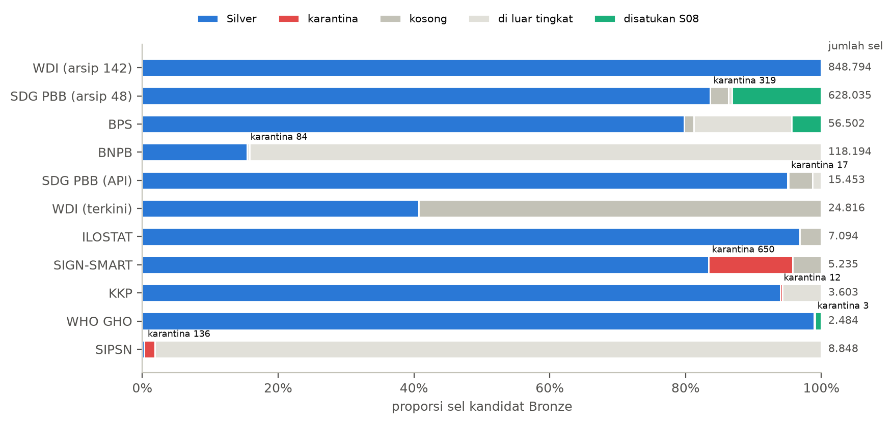
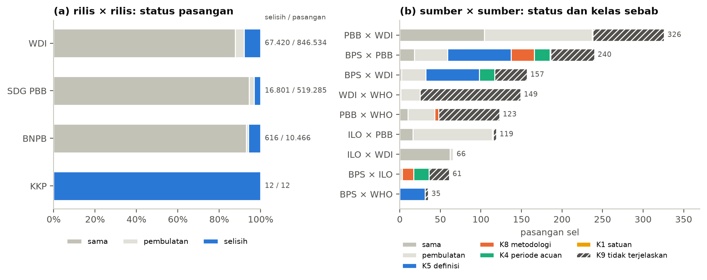
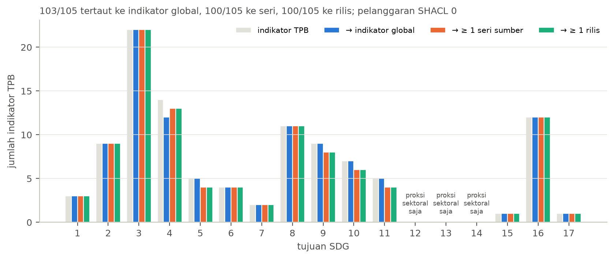
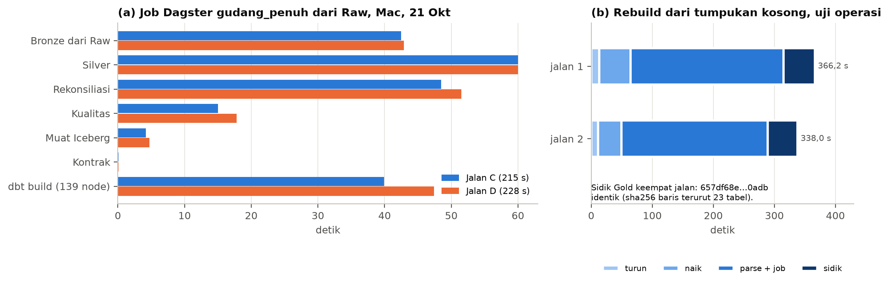
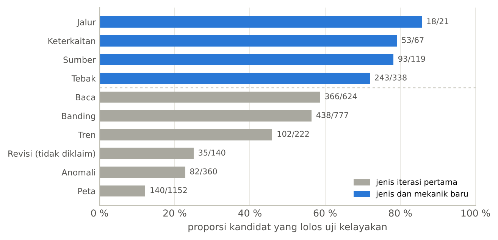
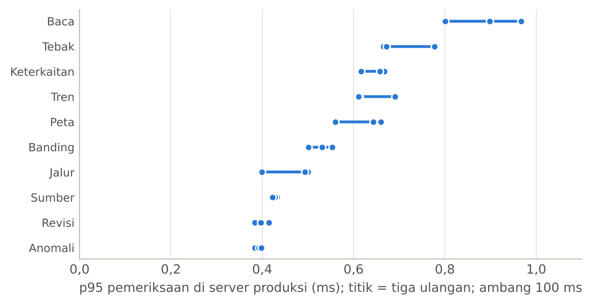
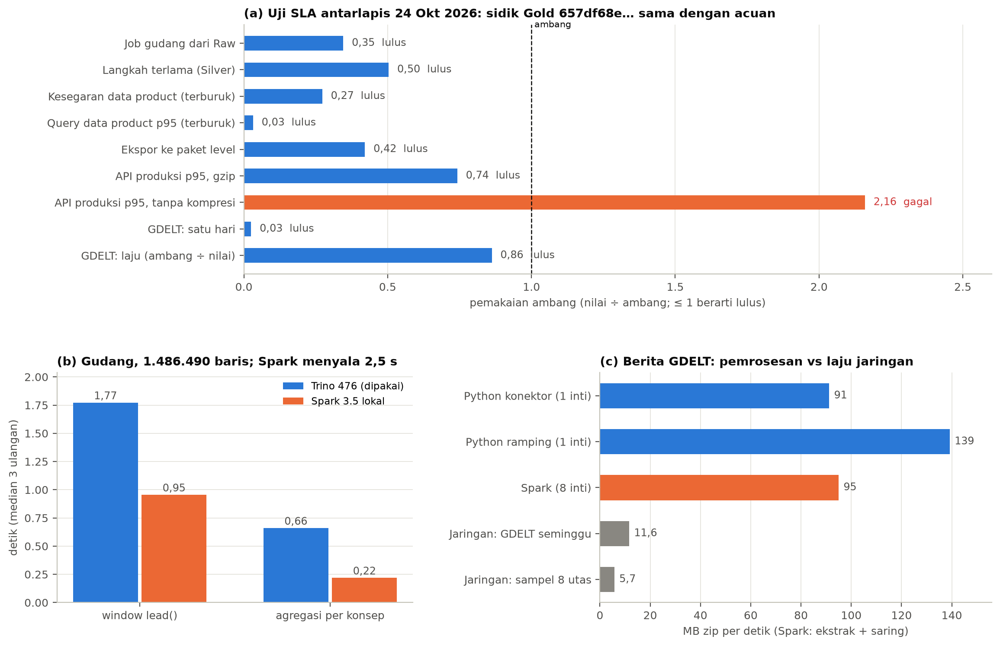

# 4. Hasil Kerja dan Pemecahan Masalah

::: {custom-style="Kotak"}
Bab ini merangkum hasil yang diperoleh gudang sebagai bukti bahwa artefaknya berjalan dan menghasilkan temuan yang dapat dipertanggungjawabkan: pemetaan Bronze ke Silver, rekonsiliasi multisumber, graf pengetahuan, operasi data mesh, lima insiden beserta perbaikannya, rantai dari gudang ke produk yang berjalan di produksi, serta uji SLA antarlapis dan pembanding Spark. Hasil penelitian lengkap beserta pembahasannya terdapat pada naskah teknis penelitian gudang dan laporan kelima pengujian Tahap II di repositori penelitian Ardika.
:::

Bagian 4.5 mencatat insiden yang terjadi selama pembangunan, karena cara insiden itu ditemukan dan diperbaiki merupakan bukti kompetensi yang sama pentingnya dengan hasil akhirnya.

## 4.1 Dari Bronze ke Silver

Seluruh 1.487.727 baris Silver dan karantina membawa sha256 berkas Raw yang cocok dengan manifest, dan identitas hitungan sel terpenuhi di semua 54 tabel sumber (`data/gudang/silver_ringkasan.json`).

**Gambar 10.** Proporsi sel kandidat Bronze yang menjadi Silver, karantina, kosong, di luar tingkat, atau disatukan S08, per sumber.

Gambar 10 memperlihatkan dua pola. Sumber internasional bertingkat nasional hampir seluruhnya terpetakan; yang tidak menjadi Silver kebanyakan sel kosong (WDI terkini 59 %) atau kunci ganda bernilai sama pada arsip PBB yang disatukan (13 %). Sumber sektoral didominasi sel tingkat kabupaten/kota (BNPB 84 %, SIPSN 98 %), yang baru menjadi provinsi lewat aturan S09. Karantina terbesar ada di SIGN-SMART (650 sel) karena kode `ID-AC` yang ambigu.

## 4.2 Rekonsiliasi multisumber

Rekonsiliasi membentuk dua jenis pasangan. Pasangan rilis × rilis dibentuk dalam satu keluarga sumber, sedangkan pasangan sumber × sumber dibentuk antarkeluarga pada konsep yang sama menurut tabel padanan seri.

**Gambar 11.** (a) Status pasangan rilis × rilis per keluarga. (b) Pasangan sumber × sumber per pasangan keluarga, dirinci menjadi sama, pembulatan, dan kelas sebab selisih.

**Tabel 4.1.** Ringkasan rekonsiliasi (`data/gudang/m3_rekonsiliasi_ringkasan.json`).

| Ukuran | Nilai |
| --- | --- |
| Pasangan rilis × rilis | 1.376.297; 90,3 % sama, 3,6 % pembulatan, 6,2 % berselisih |
| Selisih rilis × rilis yang terklasifikasi | 84.849 dari 84.849 (terutama vintage, 81.090) |
| Pasangan sumber × sumber | 1.276: 213 sama, 366 pembulatan, 697 selisih |
| Proporsi selisih sumber × sumber terjelaskan | 283/697 = 0,406 (Wilson 95 %: 0,370–0,443) |
| Kelas sebab selisih sumber × sumber | definisi 175, periode acuan 57, metodologi 49, satuan 2, tidak terjelaskan 414 |

Hasil ini menunjukkan bahwa perbedaan antarrilis umum dan dapat dijelaskan, sedangkan perbedaan antarsumber jauh lebih sulit dijelaskan. Dari 414 selisih yang tidak terjelaskan, sebagian besar terjadi antara dua sumber internasional dengan selisih relatif kecil. Contohnya angka kematian balita WDI × WHO: keduanya menyalin estimasi UN IGME, tetapi dari ronde yang berbeda. Selisih ini sebenarnya vintage antarkustodian, tetapi aturan beku tidak mempunyai kelas untuknya. Kelas tambahan dicatat sebagai usulan untuk praregistrasi berikutnya dan tidak diterapkan surut, agar angka 0,406 tetap merupakan hasil aturan yang ditetapkan sebelum data dilihat.

Dari empat hipotesis yang ditetapkan sebelum data dibandingkan, satu terbukti (TPT BPS dan ILOSTAT berselisih pada 19 dari 19 tahun) dan tiga tidak terbukti. Hipotesis yang tidak terbukti tetap dilaporkan apa adanya.

## 4.3 Graf pengetahuan dan klaim angka

Graf pengetahuan TPB-KG berisi 85.734 tripel tanpa pelanggaran SHACL, dan menautkan 103 dari 105 indikator TPB ke indikator global serta 100 ke seri dan rilis (`data/gudang/m5_kg_ringkasan.json`). Tujuan 12, 13, dan 14 hanya terwakili proksi sektoral, karena katalog TPB tingkat provinsi tidak memuat ketiganya. Uji graf pada Tahap II membangun ulang graf dari Gold dan memperoleh sha256 berkas N-Triples yang identik dengan graf M5 (`data/produk/uji-graf.json`).

**Gambar 12.** Jumlah indikator TPB per tujuan dan berapa di antaranya yang tertaut ke indikator global, ke sedikitnya satu seri sumber, dan ke sedikitnya satu rilis. Sumber: naskah penelitian gudang.

Pada 195 klaim dari Berita Resmi Statistik BPS, pemeriksa yang hanya memakai rilis terkini menyatakan 21 angka resmi BPS tidak cocok. Pemeriksaan satu per satu menunjukkan bahwa 19 di antaranya adalah angka TPT yang kemudian direvisi di tabel BPS dan 2 adalah perbandingan dengan konsep yang tidak setara. Sementara itu, pemeriksa as-of menahan vonis pada 190 klaim karena gudang baru menyimpan satu vintage tabel BPS untuk indikator sasaran. Hal ini menunjukkan bahwa pemeriksaan angka resmi memerlukan riwayat rilis; tanpa riwayat itu, pemeriksa dapat menyalahkan angka yang benar pada hari terbitnya.

## 4.4 Operasi data mesh pada infrastruktur kecil

**Tabel 4.2.** Data product pilar pada jalan acuan (`data/gudang/m4_sidik_gold.json`; nilai pilihan as-of 20 Oktober 2026, kelas A dan A-SA).

| Data product | Baris | Konsep | Wilayah | Sumber |
| --- | ---: | ---: | ---: | ---: |
| `dp_sosial_provinsi` | 21.228 | 30 | 38 | 1 |
| `dp_sosial_nasional` | 3.347 | 65 | 1 | 5 |
| `dp_ekonomi_provinsi` | 10.547 | 16 | 38 | 1 |
| `dp_ekonomi_nasional` | 6.908 | 25 | 1 | 4 |
| `dp_lingkungan_provinsi` | 17.436 | 31 | 38 | 2 |
| `dp_lingkungan_nasional` | 1.845 | 30 | 1 | 4 |
| `dp_tatakelola_provinsi` | 1.315 | 6 | 38 | 1 |

**Tabel 4.3.** Waktu langkah job `gudang_penuh` pada uji SLA 24 Oktober 2026 (`data/uji/uji-sla.json`) dibandingkan dengan dua jalan dari nol pada 21 Oktober (`data/gudang/m4_sidik_gold.json`, jalan C dan D).

| Langkah | Uji SLA (24 Okt) | Ambang | Jalan C | Jalan D |
| --- | ---: | ---: | ---: | ---: |
| Bronze dari Raw | 43,8 s | 120 s | 42,5 s | 42,9 s |
| Silver | 60,4 s | 120 s | 60 s | 60 s |
| Rekonsiliasi | 42,9 s | 120 s | 48,5 s | 51,5 s |
| Kualitas | 14,8 s | 60 s | 15 s | 17,8 s |
| Muat Iceberg | 3,8 s | 60 s | 4,2 s | 4,7 s |
| Kontrak | 0,1 s | 30 s | 0,1 s | 0,1 s |
| dbt build (139 node) | 40,7 s | 180 s | 39,9 s | 47,4 s |
| **Job total** | **207,3 s** | **600 s** | **215 s** | **228 s** |

Keempat jalan memberi sidik Gold yang sama pada 23 tabel. Menambah satu data product pilar cukup dengan satu berkas YAML 26 baris, karena pembangkit kontrak dipakai ulang. Dari 109.289 nilai pilihan, 25,7 % tidak boleh tayang karena berasal dari sumber kelas B, dan penyaringannya terjadi secara mekanis.

## 4.5 Insiden dan perbaikannya

Lima insiden terjadi selama fase gudang dan graf. Penanganannya mengikuti pola yang sama: penyebab dicari sampai akarnya, perbaikan ditempatkan di aturan atau kode (bukan di data), uji ditambahkan agar kesalahan serupa tertangkap, dan hasil sebelum perbaikan disimpan.

**Tabel 4.4.** Insiden, akar masalah, dan perbaikan.

| No | Insiden | Akar masalah | Perbaikan |
| ---: | --- | --- | --- |
| 1 | Trino terbunuh OOM saat membangun `fakta_observasi` | heap JVM bawaan 80 % tidak menyisakan memori native | batas kontainer 6 GB, heap 65 % (commit `520b95c`) |
| 2 | Rebuild pertama memberi sidik `nilai_pilihan` berbeda | satu konsep menyatukan seri berbeda ukuran, sehingga tie-breaker seri tidak deterministik | konsep diganti; dua uji ditambahkan: satu seri per keluarga per konsep, tidak ada calon setara (commit `520b95c`) |
| 3 | Satu rilis tanpa tanggal rilis terurut sebagai rilis PBB terbaru | aturan pengganti tanggal hanya mengenal tanggal snapshot (20 Okt 2026), padahal registri mencatat batas atas (29 Mar 2019); 3.771 pasangan rilis salah urut dan 3.099 nilai pilihan terdampak | tanggal efektif = tanggal rilis, lalu batas atas, lalu snapshot pertama; uji unit dan dua uji dbt kewajaran tanggal (commit `06cf95e`) |
| 4 | Jalan dari nol di Mac gagal pada tahap Bronze SIPSN | modul `lxml` tidak tercantum di berkas kebutuhan; jalan bertahap lolos hanya karena memakai Python sistem | `lxml` dipatok versinya (commit `06cf95e`) |
| 5 | Job Dagster gagal setelah uji dbt baru ditambahkan | Dagster membaca manifest dbt dari folder `target/` yang diabaikan git | `make m4-jalan` menjalankan `dbt parse` lebih dulu (commit `06cf95e`) |

Insiden 3 memberi pelajaran paling besar. Kesalahan ini tidak tertangkap oleh 137 uji kontrak yang lulus sebelum perbaikan, karena kontrak memeriksa skema, kunci, dan rujukan, bukan kewajaran urutan waktu. Kesalahan itu baru terlihat ketika data divisualisasikan untuk gambar revisi arsip pada naskah teknis. Setelah diperbaiki, proporsi terjelaskan bergeser dari 0,383 ke 0,406 dan status keempat hipotesis tidak berubah. Pelajaran yang diambil adalah bahwa tanggal rilis perlu diperlakukan sebagai data induk dengan uji tersendiri, dan perubahan ini dilaporkan bersama angka sebelum perbaikan pada naskah teknis, bukan diganti diam-diam.

Insiden 4 dan 5 hanya muncul karena gudang dijalankan ulang dari nol di mesin kedua. Keduanya tidak terlihat pada lingkungan pembangun asli, sehingga pembuktian rebuild di mesin berbeda berfungsi sebagai uji reproduksi, bukan sekadar formalitas.

## 4.6 Dari gudang ke produk yang berjalan

Tahap II menguji apakah gudang dapat menjadi sumber bagi produk yang berjalan di produksi, tidak sebatas tabel analisis. Ada tiga hasil yang relevan untuk portofolio.

**Keterulangan rantai penuh.** Pada uji operasi, rebuild gudang dari stack kosong diulang dua kali (366 s dan 338 s). Keduanya memberi sidik Gold `657df68e…`, dan keempat berkas ekspor jembatan ke paket level identik byte dengan versi ter-commit. Kompilasi paket versi 4 sebanyak dua kali (16,3 s dan 15,5 s) memberi hash paket `afbcbeef…` yang sama (`data/produk/uji-keterulangan.json`). Rantai Raw, Gold, paket level dengan demikian dapat diulang sampai bita.

**Gambar 13.** (a) Waktu langkah job `gudang_penuh` pada jalan C dan D. (b) Dua rebuild uji operasi dari stack kosong, dirinci menjadi menurunkan stack, menaikkan sampai sehat, `dbt parse` dan job, serta menghitung sidik. Keempat jalan memberi sidik Gold yang sama.

**Kelayakan paket level.** Kompilator membangkitkan 3.820 kandidat level biasa dari tabel tayang, dan 1.570 (41,1 %) lolos uji kelayakan (`data/produk/uji-kompilasi.json`). Uji kelayakan berperan seperti uji kualitas data untuk produk: kandidat yang jawabannya tidak tunggal atau dapat ditebak tanpa membaca data dibuang dengan alasan tercatat. 836 level non-revisi identik dengan paket v3 kecuali label versinya, dan 73 dari 80 Dunia v3 tetap sama.

**Gambar 14.** Proporsi kandidat level yang lolos uji kelayakan per jenis pada paket evaluasi. Sumber: naskah penelitian Liga Lakehouse.

**Operasi di produksi.** Pada server Lightsail 4 GB dengan dua worker API, pemeriksaan jawaban untuk 2.000 kiriman per ulangan mencapai p95 0,714–0,751 ms (ambang 100 ms), dan memuat paket menambah 17,6–17,7 MB memori per worker (ambang 150 MB) dalam 0,13–0,14 detik (`data/produk/latensi-produksi-*.json`).

**Gambar 15.** p95 pemeriksaan jawaban per jenis level di server produksi pada tiga ulangan. Semua jenis berada di bawah 1 ms. Sumber: naskah penelitian Liga Lakehouse.

**Perubahan dari rencana uji.** Selama Tahap II terjadi empat perubahan dari rencana uji, dan masing-masing dicatat bersama alasan dan dampaknya. Pertama, guardrail Bravais belum memuat alat baru, sehingga jalan pertama uji keterikatan diarsip dan diulang. Kedua, kartu Jalur membocorkan jawaban level lain, sehingga paket dikompilasi ulang. Ketiga, tabel bantu sempat masuk ke pencarian tabel umum. Keempat, cara menghitung jumlah level Keterkaitan pada penilaian diubah. Penanganannya sama dengan insiden gudang: penyebab dicari, perbaikan ditempatkan di kode, hasil sebelum perbaikan diarsip, dan angka dilaporkan bersama keterangannya.

## 4.7 Uji SLA antarlapis dan pembanding Spark

Uji ketersambungan antarlapis dijalankan pada 24 Oktober 2026 dengan ambang yang ditetapkan sebelumnya di `config/sla/lapis.yaml`. Gudang dibangun dari stack kosong, lalu setiap perpindahan dari Raw sampai sajian diperiksa terhadap ambangnya. Pada uji yang sama, jalur berita GDELT dijalankan pada jendela tanggal nyata, dan dua beban kerja dibandingkan dengan Spark lokal untuk menjawab pertanyaan apakah Spark diperlukan.

**Gambar 16.** (a) Pemakaian ambang setiap pemeriksaan SLA; nilai di bawah 1 berarti lulus. (b) Waktu window bitemporal dan agregasi atas Silver pada Trino dan Spark lokal. (c) Laju penyaringan berita GDELT dibandingkan dengan laju jaringan.

**Tabel 4.5.** Ringkasan uji SLA antarlapis (`data/uji/uji-sla.json`, `uji-sla-api.json`, `uji-sla-gdelt.json`).

| Lapis | Hasil | Ambang |
| --- | --- | --- |
| Ingest Raw | integritas 1,0 pada 907 berkas; snapshot terakhir berumur 4 hari | 1,0; ≤ 7 hari |
| Proses dari Raw | 207,3 s; Silver 60,4 s sebagai langkah terlama; 0 uji dbt gagal | ≤ 600 s; ≤ 120 s per langkah; 0 |
| Data product | kesegaran terburuk 109 hari; p95 query terburuk 63,6 ms | ≤ 400 hari; ≤ 2.000 ms |
| Ekspor ke paket level | identik byte 4/4 berkas, 50,5 s | identik; ≤ 120 s |
| API produksi dari luar | p95 2,2 s dengan gzip; 6,5–8,4 s tanpa kompresi | ≤ 3 s |
| Ingest GDELT 14–20 Okt | 14/14 aliran-hari lengkap, 0 gagal, 11,6 MB/s | lengkap; 0; ≥ 10 MB/s |
| Keterulangan | sidik Gold `657df68e…` | sama dengan acuan |

Hasil pembanding dibaca apa adanya (`data/uji/banding-spark.json`). Spark tidak lebih lambat; pada window gudang Spark justru lebih cepat sekitar 0,8 detik. Namun, pada skala 1,49 juta observasi kedua mesin selesai di bawah dua detik, sedangkan waktu job penuh didominasi parser Python Bronze dan Silver (104 dari 207 detik). Pada jalur berita, kapasitas penyaringan Python satu inti sudah 8–24 kali laju jaringan, sehingga menambah inti melalui Spark tidak mempercepat ingest. Oleh karena itu, keputusan tidak memakai Spark tetap dipertahankan. Bila volume tumbuh, langkah yang lebih dulu layak diparalelkan adalah parser Bronze dan Silver.
